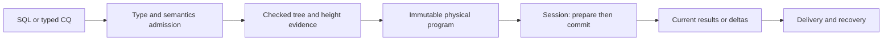

# Code review and examination guide

The initial three Astra Max reviewers examined the algorithm, native runtime and external
boundary code on 11 November 2026. Root checked their findings and implemented
the focused changes below. Scoped verification passed. The [ledger](task_ledger.md)
records component status; dated acceptance packets apply to their own frozen
sources. This review is not a full release or a proof of every execution.

The later user-requested [block inspection index](code_specs/README.md) covers
maintained source/build/test code with exact source hashes and contiguous line
ranges. [Reviewed primitives](code_specs/primitives.md) explain usage, ownership,
failure phases, costs and design references. [Error-handling dispositions](code_specs/error_handling.md)
record the direct diagnostic mapper simplification and the rollback/durable
boundaries that must remain. Generated block facts are labeled separately from
the scoped manual semantic contracts. Refresh/check maps with the standalone
documentation tools; they add no runtime instrumentation or dependencies.

The later [W03 inspection continuation](verification/w03-projected-bags-2026-11-11.md)
adds a separate read-only reviewer, direct-CQ projected multiplicities and scoped
helper/caller contracts. Its final compiler/sanitizer checks and source seal are
separate from the original review packet.

The [Boolean/native inspection continuation](verification/human-inspection-v2-2026-11-11.md)
adds 185 scoped usage cards and four justified guard/catch removals, reaching
317 contracts at that checkpoint. Original-account costs, fan-out scratch and
public/borrowed lifetimes are explicit.

The [scalar/native-table continuation](verification/human-inspection-v3-2026-11-11.md)
adds 406 scoped usage cards, clearer ownership and native journal protocols, and
a direct tuple-equality arity check, reaching 723 authored contracts at that
checkpoint. Its five-test Debug/sanitizer checks and source seal are separate.

The [frontend/catalog continuation](verification/human-inspection-v4-2026-11-11.md)
adds 149 scoped contracts, removes fixed lookup-map and successful diagnostic
string allocations, and clarifies compiler/reference costs. The current index
reached 872 contracts; other blocks remained structural maps. Six selected tests
per Debug/sanitizer profile and an independent 41-query corpus pass; complete
IR/work/diagnostic/result transcripts match sealed predecessor libraries.
Full per-block review remains active.

The [planner-proof/cursor continuation](verification/human-inspection-v5-2026-11-11.md)
adds 417 scoped contracts, including all 63 validator switch cases, reaching
1,289 contracts at that checkpoint. It clarifies original-query authority, selected work
versus real cost, shared descriptor ownership and teardown. Six raw-pointer
move casts become direct assignments with identical optimized GCC/Clang objects.
All 12 selected checks pass in each Debug/sanitizer profile, including the
complete fault sweeps and leak-checking teardown. Its acceptance/source seal is
separate from the earlier inspection checkpoints; full repository review is open.

The [candidate/session continuation](verification/human-inspection-v6-2026-11-11.md)
adds 389 scoped contracts, reaching 1,678. It covers session authority/lifecycle,
candidate enumeration/key/binding, public IR carriers and physical-plan handles.
Candidate publication now prepares geometric vector capacity before dedup
membership; replay diagnostics distinguish checked infeasibility from a finite
upper witness. Independent reviews corrected allocator, scalar-width and
validation-export claims. Its native gates are recorded in its own verification
packet; full repository review remains open.

The [lowering/ranking/selection continuation](verification/human-inspection-v7-2026-11-11.md)
adds 485 scoped contracts, reaching 2,163. Its 155 selected comments preserve
all executable C++ tokens. The independent ranking audit corrects per-primitive
failure/ownership and separates logical metadata debits, actual scans/allocations
and reused source credits. Review also reproduces a
[nonempty constant-false replanning regression](verification/constant-route-regression-2026-11-11.md);
C02 and C05 were reopened at that checkpoint. The
[constant-route repair](verification/constant-route-repair-2026-11-12.md) corrects
that defect and adds 268 contracts, reaching 2,431. Four affected planner cards
are rewritten; program, source ownership and test usage are individually
reviewed. Final 14-test Debug/sanitizer gates cover the nonempty h1/h2 body
against the canonical empty operator without changing original proof authority.
Full repository review and release gates remain open.

The [aggregate and physical inspection continuation](verification/w04-aggregates-human-inspection-2026-11-12.md)
adds 618 contracts after that checkpoint, reaching 3,049 across 2,524 mapped
blocks. It integrates the reviewed physical/ordered-row contracts and covers all
substantive assigned W04 compiler/runtime/header/test/build regions. Borrowed
compiler relation lookup removes a qualifier copy; runtime output cleanup runs
only when rendering occurs. Four aggregate and 18 foundation tests pass per
strict Debug/sanitizer profile, with independent SQL-statistic/exact numeric
oracles, allocation cuts, retained owners and an installed consumer. All 677
maintained source files / 156,013 lines are mapped; structural-only blocks remain
explicitly unreviewed semantics. Full repository inspection and release gates stay
open; 3,171 selected production blocks still lack individual cards.

The [W05 foundation continuation](verification/w05-foundations-human-inspection-2026-11-12.md)
brings the index to 3,644 source-pinned contracts. Resource, reference/dispatch,
indexed, weighted composition and annotation contracts explain actual ownership,
failure phases and costs. The narrow weighted contribution port reuses one lookup
and abort boundary; receiving factories preserve the supplied cap. All 23 selected
Debug and sanitizer tests pass, with matched allocation counts and independent
weighted oracles. Existing-source comment edits preserve executable tokens;
the current indexed guide distinguishes accounted native execution from standalone
tables. At that foundation checkpoint W05 SQL admission remained open, and 2,750
selected production blocks still required individual cards.

The [W05 SQL-row continuation](verification/w05-sql-rows-human-inspection-2026-11-12.md)
reaches 4,097 contracts in 3,544 mapped blocks across 690 files / 158,834 lines /
17,723 blocks. It covers every substantive new SQL-row compiler/runtime/test
scope, plus accounted-plan and Boolean support contracts. Comment-only edits
preserve executable tokens. One private support catch is removed after tracing
all four callers to their existing abort or RAII owner. Nullable source state
prepares allocations before native commit and publishes funded nodes afterward;
it adds no rollback framework. Cold constant liveness reduces the measured
four-alias 1 MiB-parameter fixture from sixteen retained strings to one.
Mature DuckDB/PostgreSQL agreement, native resource/fault gates and an installed
consumer pass within the documented SQL families. Individual review remains
open for 2,554 selected production blocks (564 include, 1,933 src, 57 apps).
Queued Delta/session drafts have not yet changed these counts.

The [Delta/session/cost/EXPLAIN/arena continuation](verification/human-inspection-v8-2026-11-12.md)
adds 711 contracts, reaching 4,808 in 4,228 mapped blocks across 690 files /
158,899 lines / 17,733 blocks. It integrates those drafts, qualifies final-owner
cleanup and diagnostic scans, and documents every selected assigned production
scope. The indexed profile now reports its actual admitted backend. One session
sink catch is removed after proving its failure latch already dominates every
throwing operation. Comment edits preserve executable/literal tokens; no update
instrumentation, state layer or new allocation framework is added.

All 24 selected Debug and sanitizer tests pass, including local sink faults/crash,
five indexed Delta strategies and production/testing legacy report bytes. The
first quota-description edit failed the frozen v2 byte checks; its descriptive
literal is restored while comments/docs state the true framed-byte quota. Both
profiles' direct EXPLAIN probes agree on outer/nested backend labels. The
[gap inventory for this checkpoint](../build/verification/inspection-gap-inventory-v2/README.md)
checks all 690 file hashes and reconciles every contract attachment; 1,916 selected
production blocks still need individual cards (547 include, 1,312 src, 57 apps).
Test/tool/example structural gaps remain separately visible. Input/recovery and
later capture/window/IR drafts are excluded until explicitly integrated.

The [input/recovery/window/report/IR continuation](verification/human-inspection-v9-2026-11-12.md)
reaches 5,300 contracts in 4,702 mapped blocks (690 files / 158,973 lines /
17,746 blocks). Its only executable cleanup removes an unreachable JSON integer
guard and unused capture after proving digit consumption. Reader and durable-file
handlers remain. Root corrects IR-draft allocation claims: owning containers/deep
scalars can allocate, public Decimal hashing can format, and borrowed views differ
from retaining layout/projection handles. Native headers remain unchanged by
these specs. All 18 selected Debug and sanitizer controls pass on matching inputs.
Another 1,465 selected production blocks need cards; test/tool/example gaps and
queued ranking/IO/observation reviews remain separate.

The [counter/statistics/runtime/IO continuation](verification/human-inspection-v10-2026-11-12.md)
reaches 5,635 contracts / 5,017 mapped blocks in 691 files / 159,119 lines /
17,774 blocks. A controlled real-State regression reproduces allocation after
clock cancellation; two post-clock checks now protect staging and target access
while the old owner remains usable. Sorted histogram adjacency replaces repeated
bin search, with actual probe debits and unchanged remaining reserve/model costs.
All 30 selected tests pass Debug and sanitizers on matching inputs. Original
323 registrations remain and one regression appends; no full release is claimed.
Another 1,185 selected production blocks need cards, plus separate test/tool gaps.
CLI and further header/codec drafts remain unintegrated.

The [CLI/observation/recovery/query continuation](verification/human-inspection-v11-2026-11-12.md)
reaches 6,153 contracts / 5,384 mapped blocks in 692 files / 159,262 lines /
17,813 blocks. It integrates all seven CLI files, four observation/cost headers,
journal/sink-codec/retirement and typed query/context/document scopes. Two
reproduced CLI process failures are contained at final main: stdout flush is
checked once, and diagnostic exceptions receive fixed JSON fallbacks without
retrying the command. No query update, index or cursor work is added. Existing
component handlers retain their typed roles. Whole-file/literal proofs preserve
all other code; two scalar CMake guard cards regain their actual source context.
All 26 selected tests pass Debug and ASan/UBSan/leaks on matching 1,129 inputs.
The actual-entry persistent-C++-OOM and process-I/O probes pass in both profiles.
Another 882 selected production
blocks need cards (378 include, 504 src, zero apps), plus separate test/tool gaps.

The [runtime/storage header continuation](verification/human-inspection-v12-2026-11-12.md)
adds 518 contracts without changing executable tokens: 6,671 contracts in 5,621
mapped blocks, 692 files / 159,310 lines / 17,816 blocks. Concrete owning/shared/
borrowed lifetimes, componentwise grants, native versus ordinary copy costs and
durable API barriers remain explicit. All earlier handlers and checks retain
their roles. Twenty-eight comments add 48 lines; one stale lifecycle status now
links to implemented recovery guides. Current source/anchor/link reconciliation
is separate from the preserved v11 native results; broad native tests are not
repeated for comment-only edits. Another 702 selected production blocks need
cards (198 include, 504 src, zero apps), plus separate test/tool/example gaps.

The [recovery/storage/IR continuation](verification/human-inspection-v13-2026-11-12.md)
adds 409 contracts, reaching 7,080 contracts in 5,842 mapped blocks (692 files /
159,363 lines / 17,819 blocks). It also qualifies 15 earlier storage costs.
Thirty-five comments add 53 lines, preserving complete code/literal streams.
Views, owning buffers, continuation/durable authority, numeric versus payload
lookup, explicit validation and failure/unwind costs are distinct. Digest
references point to the exact 2015 standard; these ownership rules remain local.
Current source/spec/link checks are separate from preserved v11 execution.
Another 517 selected production blocks need cards (90 include, 427 src, zero
apps); test/tool/example gaps and later drafts remain separate.
The corrected v13 v2 preservation manifest explicitly includes all three new
review packets; its initial v1 manifest and path-substitution error are retained.

The [production-inventory/IO cleanup checkpoint](verification/human-inspection-v14-2026-11-12.md)
reaches 8,460 contracts in 6,471 blocks, across 692 files / 159,290 lines /
17,831 blocks. All 5,468 selected production functions/types are covered;
test/tool/example semantic review remains separate. A source-proved private
parser deletion removes 194 lines, six direct throws and one callback alias;
all three live UTF-8 helper bodies remain token-identical. No new runtime state
or per-update overhead is added. Root corrects 56 draft public copy-semantics
records before integration, including deep key copies and move-only NativeSeed.
Both strict builds and all 24 selected tests pass Debug and ASan/UBSan/leaks on
matching 1,129 inputs. No full release, runtime speedup or whole-repository
semantic certification is claimed.

The [native-capture/tool checkpoint](verification/human-inspection-v15-2026-11-12.md)
reaches 8,972 contracts in 6,757 blocks, across 692 files / 159,357 lines /
17,852 mapped blocks. It integrates bounded example, support-header and tool
reviews, preserving the 5,468 selected production scopes. Native histogram
lookup now compares only the last bin after the existing multiplicity sort;
the actual before/after probe confirms exact facts, unchanged allocations and
reduced work debits. Offline generation preserves CRLF source identity, caches
one digest per file and disambiguates five path-specific roles. Both strict
builds and all eleven affected tests pass Debug and ASan/UBSan/leaks. Remaining
nonproduction semantic coverage and full Refactor acceptance stay explicit.

The [nonproduction inspection checkpoint](verification/human-inspection-v16-2026-11-12.md)
reaches 9,669 contracts in 7,318 blocks across 693 files / 159,435 lines /
17,883 blocks. Its 697 new cards cover remaining tools/support files, both
CMake modules, workflow/CLI tests and the previously omitted SDK template.
Production source remains byte-identical to v15. It corrects the CLI campaign
summary, strengthens exact scalar-kind comparison in the offline statistics
oracle and includes .cmake.in in both mapping inventories. Actual native CLI and
statistics report campaigns pass both profiles; source/comment/literal changes
and distinct input cohorts are reconciled explicitly. Nonproduction gaps remain
4,549 test scopes and 1,147 root CMake commands; they are not hidden by structural
coverage.

## Follow one query

SQL admission establishes the implemented language fragment. Tree checking
establishes structural validity. Minimum height additionally requires a checked
lower-bound certificate. Those steps do not establish the cheapest running plan.
The session publishes one physical input epoch after work and output preparation
succeed. Its mutable state, ownership and failure boundaries are separate from
the compiler's immutable artifacts.

For `Q(x) = R(x,y), S(y)`, inserting `R(7,9)` produces no answer until `S(9)`
arrives. Inserting `S(9)` again is a valid no-op: sequence advances, answer
membership stays unchanged. A second hidden witness can increase support without
adding a set output. Deleting the last witness removes that output. Start with
the [support invariants](support_invariants.md), then the
[independent delta specification](delta_transition_spec.md) and its test cases.

## Exact paper versions

P1 is Qichen Wang, Xiao Hu, Binyang Dai and Ke Yi, *Change Propagation Without
Joins*, PVLDB 16(5), 2023, corrected full version
[arXiv:2301.04003v2, 2 December 2023](https://arxiv.org/pdf/2301.04003v2).
The review retrieved that exact 20-page PDF, SHA-256
`147386a794fbf9b8132a62bfde2cfc4efa915f466fca5bcd0f79acbbb3bd2ff4`.

The repository's [older PDF](../Change_propagation_without_joins_full_version.pdf)
has 19 pages, SHA-256
`0865d0126179b85b7c0144669619dd218a0e914fd9c685b3dc91729ab41430e8`.
Its tree and aggregation text differs materially. It is historical reference
material; metadata alone does not identify its arXiv version. Use corrected v2
when checking the current algorithm claims.

P2 is Qichen Wang, *Towards Parameterized Hardness on Maintaining Conjunctive
Queries*, PODS/PACMMOD 2026,
[arXiv:2603.14754v1](https://arxiv.org/pdf/2603.14754v1).
The review checked the reduction definitions used below, not every hardness
proof. The residual-height recipe is not accepted as optimality authority:
local counterexamples and exact repair remain necessary.

[Refactor.md §18](../Refactor.md) and the [baseline record](source_baselines.md)
retain their pinned history. They distinguish full-text inspection, abstract
discovery, source inspection, builds and experimental reproduction. P12/P13
discovery does not justify a new exact-aggregation or approximation claim.

## Implementation, explanation and checks

Paper page numbers are one-based PDF pages in the versions above. Local proofs
and engineering choices are identified separately.

| Question | Code entry points | Paper/design explanation | Independent check |
| --- | --- | --- | --- |
| What does admitted SQL mean? | [admission](../src/frontend/admission.cpp), [binding](../src/frontend/bind.cpp), [normalization](../src/frontend/normalize.cpp), [catalog](../src/catalog/catalog.cpp) | [SQL support](sql_support.md), [semantics](semantics.md). P1 §3.1 starts from CQs; it does not specify this PostgreSQL AST frontend. | Binding/admission fixtures and SQLite comparisons. A shared SQL adapter is not independent evidence for that adapter. |
| What query class is recognized? | [recognizer](../src/planner/recognize.cpp), [safe fast paths](../src/planner/fast_paths.cpp) | P1 §3.2 defines the structural classes; its q-hierarchy incidence paragraph is unnumbered on p. 4. [Local recognition/construction proofs](planner_proofs.md) specify the implemented checks. | Recognition fixtures, small exact oracle and rejected near-miss queries. Classification alone is not minimum-height evidence. |
| What makes a tree valid? | [verifier](../src/planner/verify.cpp), [tree types](../include/crown/ir/tree.hpp) | P1 §3.2, Definitions 3.1–3.2, pp. 3–4; [local invariants](planner_proofs.md). Corrected v2 permits hidden root variables. | `tree_verifier`, malformed-tree and certificate controls. |
| Why is minimum height proved? | [search](../src/planner/exact.cpp), [independent replay](../src/planner/certificate.cpp) | [Partition recurrence and finite normal form](planner_proofs.md) are original local arguments, not a P1 minimum-height algorithm. | `exact_oracle`, continuation and proof-corruption tests; valid upper witness plus checked lower bound. |
| How are residual candidates used? | [reduction](../src/planner/residual_reduce.cpp), [trace replay](../src/planner/residual_trace.cpp), [reconstruction](../src/planner/residual_reconstruct.cpp) | P2 §2.1.4, Definition 2.9/Algorithm 1 p. 6 and Definition 2.10 p. 7; [local repair](residual_candidates.md). | `planner_residual`, `planner_residual_exceptions`; seven/nine-atom counterexamples. |
| What does lowering construct? | [compiler](../src/planner/lower.cpp), [accounted native lowering](../src/ir/program_replan.inc) | P1 §4.1, Algorithm 1/equations (2)–(4), p. 4; [physical program](physical_plans.md). | Physical/native/selection parity. Separate representations retain different ownership obligations. |
| How does support propagate? | [support](../src/runtime/support.cpp), [physical coordinator](../src/runtime/physical.cpp) | P1 §4.2, Algorithms 2–4, p. 5; [support invariants](support_invariants.md), [runtime contract](runtime_support.md). Atomic self-join fanout/rollback are additional engineering contracts. | Independent subtree/reference comparisons, event/journal checks and allocation cuts. |
| How are outputs enumerated? | [current cursors](../src/runtime/support.cpp), [deltas](../src/runtime/delta.cpp) | P1 §5.1 Algorithm 5/§5.2 Algorithm 6, pp. 5–6; [cursors](result_cursors.md), [local partition proof](delta_transition_spec.md), [ordered replay](ordered_delta.md). | Hidden witnesses, unchanged-root changes, self-joins, Boolean results and last-witness deletion. Finite agreement does not establish a delay bound. |
| Why the ownership and rollback machinery? | [memory](../src/resource/memory.cpp), [storage](../src/storage/accounted_table.cpp), [session](../src/runtime/session.cpp) | [Query memory](query_memory.md), [lifecycle](delta_lifecycle.md): engineering contracts, not P1 allocator/exception theorems. | Exact/one-under budgets, unchanged previous epochs, allocation-free publication and cleanup. |
| How do delivery and recovery fit? | [WAL](../src/recovery/journal_file.cpp), [generations](../src/recovery/generation.cpp), [sink](../src/recovery/local_sink.cpp), [session integration](../src/runtime/session.cpp) | [Generations](generations.md), [replay](native-replay.md), [delivery](local-sink.md), [reoptimization](reoptimization.md). | Corruption/I/O/process-crash controls and exact next input/output. Process exits do not establish power-loss behavior. |
| What does cost selection establish? | [statistics](../src/runtime/owner_statistics.cpp), [ranking](../src/planner/ranking.cpp), [selection](../src/planner/selection.cpp) | P1 §6.3 is context for the depth baseline. [Ranking](ranking.md), [exact binding](selection_binding.md), [held-out evaluation](ranking_evaluation.md) define actual local policies. | Exact integer scores and measured feasible-candidate regret. Unitless scores are not nanoseconds or global optimum certificates. |
| What do annotations mean? | [policy types](../include/crown/annotations/policy.hpp), [arithmetic](../src/annotations/policy.cpp) | P1 §7.3, equations (10)–(14), pp. 12–13 gives weighted context. [W01](annotations.md) defines bounded arithmetic/support rules only. | `annotation_policy`, `annotation_admission`, Python integer/fraction oracle. SUM cancellation cannot erase a live group. SQL aggregates remain W04–W06. |
| Why are projected counts exact? | [weighted messages](../src/runtime/weighted.cpp), [compressed cursor](../src/runtime/weighted_cursor.cpp) | P1 v2 §7.3 equation (10) excludes C* children. [Full messages](weighted_messages.md) and [local factorization/caller contract](weighted_enumeration.md) have distinct roles. | Independent unbounded native-assignment oracle; counted-path, hidden/generalized, duplicate-weight and reader/failure controls. No Boolean numeric bound or constant public delay claim. |
| Can the executed bytes be reproduced? | [workflow](../apps/crown/workflow.cpp), [clean source](../tools/verify_clean_build.py), [measurement](../tools/run_measurements.py), [native workflow example](../examples/native-workflow/main.cpp) | [CLI/install](cli.md), [measurement scopes](measurement.md), [build guide](native_build.md): engineering evidence, not theorem evidence. | Source-only configure/manifests, stale-link rejection, moved installation, raw commands and receipts. |

## Findings and disposition

The static reports give exact original locations and triggers. Root's changes
add no exception scaffolding to annotation arithmetic and preserve the real
transaction, budget, proof and ownership boundaries.

| Finding | Focused change | Verification |
| --- | --- | --- |
| Rejected residual grafts retained unused verifier workers | Release the worker; keep rejection count and cumulative logical charge | Existing counterexample/ownership and persistent-OOM controls |
| Legacy recovery allocated its final owner after tail repair | Fund that owner in the receiving account before replay; install by move | Pre-fix defect reproduced; torn WAL/sink allocation sweep, retry, exact/one-under caps, both backends |
| Direct support no-ops bypassed C01/O07 | Complete no-op tickets without a journal/transaction | Census, sampling, measured-zero and allocation parity |
| P/E capture caught the wrong indexed work exception | Handle actual typed work exhaustion and retain exact earlier components | Native-grant exhaustion with completed prefix and unknown partial distribution |
| Clean-source copies omitted required inputs | Include examples, benchmarks, install guide and exactly 122 pinned baseline files | Real configure and workload/import/ranking checks |
| Metadata could pair rebuilt libraries with stale executables | Check source/header/flags→object→archive→executable freshness; keep hashes | Real tiny CMake stale library/member, partial relink and changed-flags controls |
| Workflow DOM parsing erased duplicate-key evidence | Use one strict public JSON reader before nested reconstruction; examples share it | Top-level/nested duplicate keys and nesting-limit negatives |
| Indexed selection-key prose omitted fields/version branches | Document all 14 capacities/allowances and both prefixes | Match actual encoder/backend binding checks |
| Paper/version and stale guide language confused source claims | Add exact links/hashes; identify historical checkpoints | This map, paper artifacts and the current ledger |

Freshness timestamps detect ordinary stale builds; they are not cryptographic
build lineage against deliberately altered timestamps. A source hash identifies
bytes but alone does not prove a compiler used them.

One compatibility issue remains: EXPLAIN schema v2 freezes historical
`open_gates` and `durable_delivery:not_implemented` labels. They do not report
current project completion or actual sink state. Use session delivery/recovery
state and the ledger. A current capability report requires a separate version;
changing frozen constants would invalidate historical readers and byte checks.
See [observability](observability.md).

## Keep the implementation direct

Every retained object or abstraction should have a named consumer and a clear
invariant. Translate errors at actual public/ownership boundaries. Undo journals,
pinned views, receiving accounts and independent proof replay have concrete
jobs; removing them would weaken correctness.

Optional follow-ups are separate reviewable changes: share duplicate backend
test scenarios, centralize identical bounded JSON writer mechanics, expose the
checker's existing rejection reason, and replace anonymous certificate stages
with named states. Do not merge independent oracle/checker logic just to reduce
duplication or introduce a generic framework for these small cleanups.

## Coverage and retained evidence

This section records the historical W01 review checkpoint. Its counts and
compiler matrices apply to the frozen source named below.

All 302 maintained implementation/header paths were inventoried. The algorithm
review read 65 files; the native review structurally inspected 147; boundary review
covered 89. Root inspected the remaining version header. Deep reasoning focused
on proof admission, update/ownership/recovery, frontend and serialization
boundaries, build provenance and W01 arithmetic.

Tests, scripts, schemas and docs were inventoried and reviewed at different
depths. Every fixture branch and vendored/legacy line was not independently
proved. Scala/Flink, DBToaster modifications, original experiments and vendored
archives remain distinct baseline/dependency material, not this native engine.

- [Algorithm report](../build/verification/review-algorithms-v1/review.md)
- [Native report](../build/verification/review-native-runtime-v1/report.txt)
- [Boundary report](../build/verification/review-boundaries-docs-v1/review.md)
- [Root inventory](../build/verification/review-overview-v1/inventory.json)

Reviewers ran no builds/tests and changed no project sources. At that checkpoint,
root's gates passed 27 GCC Debug, 33 fresh source-only GCC Release, 14 Clang Release and nine
ASan/UBSan/leak checks, plus four moved installed workflows and a separate public
annotation consumer. Every arithmetic run agrees with 15,588 independent exact
integer/fraction cases. Legacy recovery passes 1,879 allocation cuts on both
backends, with incomplete WAL/sink tails, retry, exact/one-under heap and the
next input/output. The existing selected-plan sweep still passes 1,105 cuts.

The [source/artifact audit](../build/verification/w01-review-acceptance-v1.json)
checks 15 requirements, 1,082 then-current code inputs, 143 actual top-level native
archives/executables, 696 C++ compilation records and ten final receipts.
All 302 predecessor registrations remain unchanged; 308 are registered. No full 308
execution is claimed. Frozen source is under `build/w01-review-source-v1`;
failed developer fixtures/reproducers and their raw logs are retained separately,
including the corrected workflow command form. Larger optional cleanups and the
EXPLAIN versioning issue above remain open. W01 is verified; the full Refactor.md
objective and release gates remain active. Historical sealed evidence is unchanged.

The [root CMake continuation](verification/human-inspection-v17-2026-11-12.md)
adds 1,147 command cards, reaching 10,816 source-pinned contracts. Five collision
libraries move under the existing testing guard, removing exactly five targets
from a test-disabled default build. Direct in-place variable-term construction
also resolves an observed strict Release compiler warning. Four collision and
three SQL regressions pass in each Debug/sanitizer profile; all 325 commands and
execution properties remain after excluding source-line backtraces. Remaining
selected manual gaps are 4,549 test scopes; W06 and release remain open.

The [weighted-delta and test continuation](verification/human-inspection-v18-2026-11-12.md)
reaches 11,229 source-pinned contracts. It supplies an opt-in native projected net
with direct causal capture, original-account/grant reuse and no new production
catch. Root adopts one anchor-scan early exit after focused Astra acceptance;
actual work falls by 31 units on a 32-step probe without allocation/output changes.
Ten selected weighted/SQL checks pass per Debug/sanitizer profile, alongside a
moved strict C++23 SDK consumer. Another 348 cards inspect unchanged statistics,
memory-account and cost tests. Remaining selected test gaps are 4,201; physical
aggregate/recovery integration and the full Refactor/release goal remain open.

The [prepared-source continuation](verification/human-inspection-v19-2026-11-12.md)
adds 78 contracts, reaching 11,307. It documents final touched constraint checks
and one native epoch without a new catch or source undo framework. Root fixes
closed-token workspace retention and qualifies ordered-map publication costs.
Four SQL checks pass per Debug/sanitizer profile, alongside the complete
test-disabled Release build and relocated installed consumer. All 326 prior
test definitions remain; only sql_rows_batch is added. Existing single-row
allocation/work probes stay equal apart from a fixed 48 accounted bytes.
Aggregate composition/recovery and remaining test semantic review stay open.

The [prepared-aggregate continuation](verification/human-inspection-v20-2026-11-12.md)
reaches 11,502 contracts, including all 5,554 selected production scopes. Final
group proposals reuse the exact arithmetic and one Budget; batch-only counters
leave existing value layouts unchanged. Four aggregate checks pass per
Debug/sanitizer profile, alongside Release and moved SDK usage. Another 153 cards
inspect unchanged candidate/initialization fault tests. A focused Astra review
finds grouping-admission and unsafe upstream-clone problems in the next compiler
proposal; root reproduces the grouping defect before production adoption.
Remaining test gaps are 4,048, and genuine coordination/recovery stays open.

The [V33 requirement and usage review](verification/human-inspection-v33-2026-11-13.md)
closes the bounded W06 interruption gap without changing production code.
The actual mixed nullable self-join matrix runs both backends with compressed
COUNT at INT64_MAX, signed cancellation and two real arithmetic Rejects. Each
Debug/sanitizer profile checks 784 EIO cuts and 156 actual process exits, with
exact surviving source/group/progress/sink state and a valid next operation.
The report separates actual syscall cuts, source-derived RAM-stage equivalence,
independently decoded healthy tapes and predecessor execution evidence.
Another 99 usage cards bring the registry to 15,437; 1,164 selected test regions
remain. All production bytes equal V32, so no hot-path storage, work, catches
or runtime dependencies are added. R2 retirement and full release gates remain
open; W06 verification does not imply a complete all-code semantic review.

The [V34 source-usage continuation](verification/human-inspection-v34-2026-11-13.md)
adds 160 scoped cards: 154 across retained-memory/physical/support tests and six
offline aggregate-role labels. Root and peer reviews distinguish shared values
from mutable runtime ownership, copied snapshots from journal pins, selected
work metrics from actual copying/lookup work, and one aggregate IndexWork grant
from its five dimensions. The receiving geometry check adds two missed main
functions while retaining valid alias cards. There are 15,597 cards and 1,012
selected test gaps. Only display-role metadata changes; all 355 production paths
and every test/fixture/build definition remain byte-identical to V33. No new
native test, package or timing execution is claimed.

The [V35 source-usage continuation](verification/human-inspection-v35-2026-11-13.md)
adds 181 reviewed cards across selection/ranking memory and independent planner
oracles. Exact actual gap-set reconciliation includes all seven entrypoints;
source/peer reviews distinguish sampled allocation faults, finite work grants,
shared candidate handles, account-ID evidence, source-derived call counts and
independent expected arithmetic from production operand construction. The map
has 15,778 contracts with 831 selected test gaps. All 1,196 native inputs equal
V34; there is no added runtime handler, wrapper or instrumentation. No new native
execution, performance measurement or broad semantic/release claim follows.

The [V36 usage review](verification/human-inspection-v36-2026-11-13.md) adds 176
cards for native replanning, private barriers, durable installation and actual
memory/work contracts. Root and independent reviewers distinguish canonical
source sharing from deep copy, raw record framing from semantic admission,
selected attribution totals from account identity, and observed syscall cuts
from broader crash claims. The map has 15,954 contracts and 655 selected test
gaps. All 1,196 native inputs remain identical to V35; no runtime mechanism,
native execution, timing result or release certification is added.

The [V37 usage review](verification/human-inspection-v37-2026-11-13.md) adds 178
cards for planner continuation, exact delta specifications, reference candidate
families, SQL normalization and static physical lowering tests. It distinguishes
checked authority from progress, selected transition counters from full CPU/
byte/delay work, and materializing test models from production primitives. The
map has 16,132 contracts and 477 selected test gaps. All 1,196 native inputs
remain identical to V36; no runtime machinery or fresh native execution is added.

The [V38 usage review](verification/human-inspection-v38-2026-11-13.md) adds 220
cards for memory, journal/index/work and reoptimization boundaries. It separates
native ownership/copy rules, selected counters, original durable decisions,
recovery preflight and publication. The map has 16,352 contracts and 257 selected
test gaps. All 1,196 native inputs remain identical to V37; no runtime machinery
or fresh native execution is added. One stale descriptor success-count diagnostic
has an explicit next native follow-up; its actual loop count is documented.

[V39 acceptance](verification/human-inspection-v39-2026-11-13.md) completes V38's
required descriptor diagnostic correction. The single success literal now matches
twelve existing variants; eight source-bound cards are re-reviewed. Strict affected
Debug and ASan/UBSan/leak checks pass 1/1 each; all 355 production paths are unchanged.
The 16,352-card total and exact 257 selected test gaps remain unchanged.

[V40 inspection](verification/human-inspection-v40-2026-11-14.md) adds 257 scoped
usage cards and closes the selected callable/type/inline-cluster gap set. The
16,609 contracts remain distinct from 5,219 structural-only blocks and from
proof of every comment or full Refactor completion. Full source/peer/root review
corrects fixture mappings, authority boundaries, resource/cost scope and helper
usage; all 1,196 native inputs remain identical to V39. A narrow backend diagnostic
wording correction is the next required native follow-up.

[V41 acceptance](verification/human-inspection-v41-2026-11-14.md) corrects the
backend-binding success literal: fourteen varied fields include two whose base
values exceed 2^53. Four cards are re-reviewed, two semantic fields and one main
anchor clarify actual source behavior. Strict affected Debug and ASan/UBSan/leak
checks pass 1/1 each; all 355 production paths remain unchanged. The 16,609-card
total, zero selected gaps and 5,219 structural remainder retain their explicit scope.

[V42 inspection](verification/human-inspection-v42-2026-11-14.md) adds 39 public
declaration/alias cards, distinguishing declared type/access/storage effects from
runtime calls and cleanup. Canonical work aliases do not refill grants, accounted
borrows need retained owners, and shared-owner final release is not uniformly
constant. The index has 16,648 contracts with zero selected gaps and 5,180 remaining
structural blocks. All 1,196 native inputs remain identical to V41; no new execution
or runtime inspection machinery is introduced.

[V43 inspection](verification/human-inspection-v43-2026-11-14.md) adds 46 public wire/IR
declaration cards, distinguishing owning values and borrowed native views, parsed
DTOs and typed checked authority, encoded-byte limits and complete memory costs.
R2 transport and successful inspection do not imply file durability or native
replay. The index has 16,694 contracts with zero selected gaps and 5,134 remaining
structural blocks. All 1,196 native inputs remain identical to V42; no new execution
or runtime inspection machinery is introduced.

[V44 inspection](verification/human-inspection-v44-2026-11-14.md) adds 23 test
instrumentation and fixture cards. Attempt counters, requested bytes, account
charges and CPU evidence have separate scopes; temporary-borrow static assertions
do not guarantee saved-pointer lifetimes. Ignored cells retain physical row
identity. The index has 16,717 contracts, zero selected gaps and 5,111 remaining
structural blocks. A separately sealed audit amendment corrects numeric-separator
classification while preserving the original packet. All 1,196 native inputs
equal V43; no native execution or runtime machinery is added.

[V01/V45 acceptance](verification/v01-documentation-2026-11-14.md) supplies a current
SQL-only quickstart, syntax/support matrix, guarantee, troubleshooting and
query/extension guides. Fresh Release installation, 18 independently checked
SQL epochs, durable deltas/restart, all five shipped examples and the extracted
cursor program pass. Two reader comments now name the full consuming-failure
scope; complete C++ tokens/regions are unchanged, with exact 44-hash/one-invariant
registry replay. The 5,111 structural blocks remain unchanged and open. This
closes V01, not independent whole-system mathematics, experiments or release.
