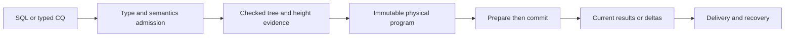

# Code review and examination guide

Use the [block index](code_specs/README.md) to inspect a source range and its
[primitive contract](code_specs/primitives.md), then follow the
[independent guarantee review](independent_review.md) for the argument and
counterexample behind a public claim. [Error-handling dispositions](code_specs/error_handling.md)
explain which catches provide rollback, reader cleanup or uncertain-I/O latching.
The [ledger](task_ledger.md) and [handoff](handoff.md) record current acceptance.

The index maps **900 files / 202,375 lines / 22,533 blocks**. Its **21,731 authored
contracts cover all 19,205 nonblank blocks**. The remaining 3,328 regions contain
only blank spacing and retain structural descriptions. All selected callable,
type and substantive inline-cluster gaps are zero. A mapped line is inspectable,
not proved correct.

The [V58 full-scope review](verification/full-scope-review-v58-2026-11-15.md)
receives all 370 production paths and the then-complete 433-path primary inventory.
Both existing 362-check profiles pass. The [V59 integration](verification/component-evaluation-v59-2026-11-15.md)
adds experimental upper-tree admission, direct runtime controls and held-out
planning orchestration, with separate source-bound checks. The
[V60 review](verification/component-evaluation-v60-2026-11-15.md) receives all
446 then-current primary code/configuration paths and the exact successors to those
clients, plus operational, baseline and independent literal-search studies.
All 370 production files retain the reviewed V59 bytes. The Scala
replay adapters use generic structural chunks; their source cards do not claim
Scala method/AST completeness. The [V61 full-scope review](verification/full-scope-review-v61-2026-11-15.md)
receives 455 then-current primary code/configuration paths and 377 test-code paths.
It reviews independent query ownership, prepared SQL input execution, their cache
integration and reproducible report tools. Production scope is 373 paths: 365
unchanged from V60, five changed and three new. Exact validation cohorts and
remaining report/release qualifications are recorded in that review.
The [V62 full-scope review and R1 freeze](verification/r1-release-v62-2026-11-15.md)
adds offline packaging and clean-source/test changes, with 456 then-current primary
code/configuration paths and 378 test-code paths. All 373 production files keep
their reviewed V61 bytes. Both complete 376-test profiles pass; the final archive
joins all source/compiler dependencies and every tested SDK file. The separate
local R1 decision accepts the documented equality-set scope. Finite executions
and package identity supplement the source arguments; broader R2 work remains open.

The [V63 row-recovery review](verification/sql-rows-recovery-v63-2026-11-16.md)
receives its then-current 856-code-file map and 20,671 authored contracts across all
18,206 nonblank regions. Current scope is 472 primary code/configuration paths,
386 test-code paths and 389 production files. Both complete builds and all 383
current tests pass in Release and ASan/UBSan, without failures/skips or code/
configuration drift. The final R2 report/artifact remain separate gates. Exact retained
old cards, semantic amendments, source anchors and metadata changes have explicit
lineage; syntactic coverage alone is not a correctness proof.

V64 changes two release Python files for explicit R2 packaging and its independent
archive/install regression. Root and an independent reader receive 44 current
contracts with 34 old-record lineage, preserving 20,637 unaffected records. The
current registry has 20,681 contracts and covers all 18,207 nonblank regions. All 389
production files and 25 tested Release SDK native payloads remain unchanged from
V63. New targeted tooling/candidate receiving passes with its own source vintage;
the original full 383-test suites are not relabeled as newer whole-source executions.
The [V64 review](verification/r2-package-v64-2026-11-16.md) and separate internal
R2 decision receive the exact image without changing its archived WIP metadata.

The [V65 full-scope review](verification/full-scope-review-v65-2026-11-16.md)
semantically inspects all 472 primary code/configuration paths, including all 389
production files. It fixes the aggregate descriptor's cold work-refusal category
and corrects the window FIFO comment/class contract. Three semantic card amendments
and 112 source/anchor bindings preserve all 20,566 unrelated records. The review
keeps full/targeted reading, inherited test-body inspection and actual execution
separate, with independent SQL, integer/Fraction and window models. The correction
adds no per-update work or exception framework; archived R1/R2 images retain their
original source points.

The [V66 full-scope review](verification/full-scope-review-v66-2026-11-16.md)
joins all 863 maintained code/configuration paths to their inspection depth.
All 389 existing production files preserve exact V65 bytes; the two new
production files implement [exact snapshot top-k](topk.md). Their source/tests,
appended build metadata and offline documentation context receive 117 new
contracts. Of 1,732 existing rebindings, two amend documentation-routing
semantics; 18,949 unrelated records remain exact. An independent reader checks
all changed/new source bindings and block coverage. The
[feature acceptance](verification/snapshot-topk-v66-2026-11-16.md) separates
local collect/sort costs from specialized paper bounds and SQL clause admission.

The [V67 key-specialization acceptance](verification/key-specialization-v67-2026-11-16.md)
adds two cold production files while preserving all 391 existing production
files exactly. Enforced-key rewrites retain complete source validation and
separately bound reduced-query proofs; no runtime owner, catch/retry layer or
P5 update bound is added. Both new registered checks pass Release and ASan/UBSan
on both backends, with independently received relocated SDK execution. There are
128 new usage contracts, 1,760 metadata rebindings with two routing amendments,
and twelve citation-only corrections for five stale inherited reference strings.
All 19,026 unrelated records remain exact. Current numeric reference ranges and
all nonblank blocks are independently received; historical full-suite vintages
remain explicit.

The [V68 full-scope review](verification/full-scope-review-v68-2026-11-16.md)
receives all 868 maintained code/configuration paths, including all 393
production files, with no production edits. Fresh runtime, storage/recovery,
planning, root and bounded Astra key reviews distinguish actual reading depth
from inherited source-identical review. Both complete current builds and all
387 tests pass in Release and ASan/UBSan: 774 executions, zero failures/skips,
unchanged source, build metadata and registrations. Current usage-contract
bindings and links pass. The review finds no new actionable defect and adds no
runtime overhead, new exception framework, feature acceptance or release image.

The [V69 star acceptance](verification/heavy-light-star-v69-2026-11-16.md)
adds seven production files while preserving all 393 earlier production files.
All new admission, H, groups, journal and cursor source is reviewed; independent
pre-repair findings, corrected iterator controls and scoped successor receiving
retain their actual bytes. Both added registered commands pass Release and
ASan/UBSan, alongside a relocated SDK and held-out general/star comparisons.
There are 240 new contracts, 1,789 old rebindings with seven context/routing
amendments, and 19,137 exact unrelated records. V68's full 387 and V69's targeted
two-command cohorts remain distinct. The [star cost profile](star.md) separates
local candidate bounds from full P2, source validation and cleanup costs.

The [V70 comparison acceptance](verification/comparison-support-v70-2026-11-16.md)
adds four production files while preserving all 400 earlier files. Typed predicates
remain separate from equality identity; full assignments are filtered before head
projection and exact deltas are prepared before source commit. Current targeted
Release/ASan/UBSan, authenticated allocation/producer refusal, independent original
models and relocated SDK checks pass. There are 157 new cards, 1,823 old rebindings
with nine semantic context/routing amendments, and 19,343 exact unrelated records.
Full prior suites retain their vintages; no full 391 suite or P9 dynamic claim.

The [V71 fallback/current-inventory review](verification/general-query-fallback-v71-2026-11-16.md)
receives all 894 code/configuration paths and 409 production files: 402 old exact,
two additive physical files and five new fallback/source-image files. Actual
cyclic/non-free-connex classification, iterative full-witness evaluation,
original-account capture, exact endpoint deltas and refusal/publication arguments
receive current source contracts and bounded independent review. Both profiles
pass nine selected commands; prior full-suite vintages remain explicit. Current
maps cover every nonblank region, while advisory bounds and full materialization/
cleanup costs remain separate from CROWN/GHD guarantees.

The [V72 difference/shared-CQ review](verification/difference-v72-2026-11-16.md)
receives all 902 code/configuration paths and 414 production files: 408 old exact,
one fallback successor and five new. A shared account-backed freezer/iterative
visitor avoids duplicated positive-CQ code. Explicit SET EXCEPT and BAG EXCEPT ALL
use one source image and exact endpoint count replacements. Both profiles pass
five targeted commands, independent oracles and a relocated SDK; all source/block
lineage and actual count/materialization costs remain explicit. Full prior suites
retain their vintages; no full 396 or P11 maintenance claim is implied.

The [V49 inspection record](verification/human-inspection-v49-2026-11-14.md)
received 2,148 then-remaining nonblank blocks, including declarations, comments and
scope boundaries. Each has an exact source binding and scoped usage fields.
The [anchor format](code_specs/anchor_format.md) explains repeated syntax and
checksum binding. Comment cards describe the role and limits of the note;
they do not certify every assertion in retained source comments.

Each scoped contract identifies use, input/output, invariant, ownership, failure
phase, cost and source/design reference. Read its callers before extending it to
a different path. Existing source comments and finite test results do not supply
a missing general argument. The full Refactor and release gates remain open.

## Follow one query

For `Q(x) = R(x,y), S(y)`, inserting `R(7,9)` produces no answer until `S(9)`
arrives. Inserting `S(9)` again is a valid no-op: sequence advances while answer
membership stays unchanged. A second hidden witness can increase support without
adding a set output; deleting the last witness removes that output. Follow the
[support invariants](support_invariants.md), then the
[delta specification](delta_transition_spec.md) and [ordered replay](ordered_delta.md).
SQL bags use separate weighted and source-identity contracts.

## Exact paper versions

P1 is Qichen Wang, Xiao Hu, Binyang Dai and Ke Yi, *Change Propagation Without
Joins*, PVLDB 16(5), 2023, corrected full version
[arXiv:2301.04003v2, 2 December 2023](https://arxiv.org/pdf/2301.04003v2).
The review retrieved that exact 20-page PDF, SHA-256
`147386a794fbf9b8132a62bfde2cfc4efa915f466fca5bcd0f79acbbb3bd2ff4`.

The repository's [older PDF](../Change_propagation_without_joins_full_version.pdf)
has 19 pages, SHA-256
`0865d0126179b85b7c0144669619dd218a0e914fd9c685b3dc91729ab41430e8`.
Its tree and aggregation text differs materially. It is historical reference
material; metadata alone does not identify its arXiv version. Use corrected v2
when checking the current algorithm claims.

P2 is Qichen Wang, *Towards Parameterized Hardness on Maintaining Conjunctive
Queries*, PODS/PACMMOD 2026,
[arXiv:2603.14754v1](https://arxiv.org/pdf/2603.14754v1).
The review checked the reduction definitions used below, not every hardness
proof. The residual-height recipe is not accepted as optimality authority:
local counterexamples and exact repair remain necessary.

P3 is Jiang, Wang and Koch, *Succinct Structure Representations for Efficient
Query Optimization*, [arXiv:2603.15465v2](https://arxiv.org/html/2603.15465v2).
The exact PDF SHA-256 is
`dbd53bf991c4b19d825d0d4e7dcdf3285acf629c33de314c1ba0c4c8552a62cb`.
The [meta-decomposition guide](meta_decompositions.md) identifies Definition 4.3,
Algorithm 1, the stronger admitted minor guard and the fixed-point interpretation.
The [candidate adapter](meta_candidate_adapter.md) adds bounded ordinary expansion
and a local normalized generalized inverse mapping. Paper enumeration and static
cardinality confer no generalized-height or maintenance-cost proof; the adapter
requires an independent original minimum certificate.

[Refactor.md §18](../Refactor.md) and the [baseline record](source_baselines.md)
retain their pinned history. They distinguish full-text inspection, abstract
discovery, source inspection, builds and experimental reproduction. P12/P13
discovery does not justify a new exact-aggregation or approximation claim.

## Implementation, explanation and checks

Paper page numbers are one-based PDF pages in the versions above. Local proofs
and engineering choices are identified separately.

| Question | Code entry points | Paper/design explanation | Independent check |
| --- | --- | --- | --- |
| What does admitted SQL mean? | [admission](../src/frontend/admission.cpp), [binding](../src/frontend/bind.cpp), [normalization](../src/frontend/normalize.cpp), [catalog](../src/catalog/catalog.cpp) | [SQL support](sql_support.md), [semantics](semantics.md). P1 §3.1 starts from CQs; it does not specify this PostgreSQL AST frontend. | Binding/admission fixtures and SQLite comparisons. A shared SQL adapter is not independent evidence for that adapter. |
| What query class is recognized? | [recognizer](../src/planner/recognize.cpp), [safe fast paths](../src/planner/exact.cpp) | Classical GYO recognizes body and body-plus-head alpha-acyclicity. P2 §2.1.1 p. 4 states the native-anchor generalized-scope convention; P1 §3.2 p. 4 gives the q-hierarchy incidence condition. [Local recognition/construction proofs](planner_proofs.md) specify the implemented checks. | Recognition fixtures, small exact oracle and rejected near-miss queries. The [class bridge](planner_proofs.md#free-connex-class-and-tree-existence) connects recognition with admitted-tree existence; minimum-height evidence is separate. |
| What does meta construction check? | [metadata API](../include/crown/planner/meta.hpp), [construction/checker](../src/planner/meta.cpp) | P3 Definition 4.3 / Algorithm 1, PDF pp.10–12; [qualified interpretation and costs](meta_decompositions.md). | Eleven literal graphs, malformed metadata, exact/one-short grants, and 7,750 GYO comparisons per profile. These do not prove enumeration coverage or supply a CROWN tree. |
| How does meta enumeration reach CROWN plans? | [ordinary expansion](../src/planner/meta_join_trees.cpp), [inverse mapping](../src/planner/meta_candidates.cpp) | P3 §4.2 / Algorithms 2 and 5 / Appendix C.7 plus the [local inverse argument and explicit domain](meta_candidate_adapter.md). | Exact ordinary families, 12 normalized minimum families, 26 four-leaf hierarchies, six-occurrence controls, P02 replay and separate exhaustion/limit tests. No unary-shape or global maintenance-cost coverage. |
| What makes a tree valid? | [verifier](../src/planner/verify.cpp), [tree types](../include/crown/ir/tree.hpp) | P1 v2 §3.2, Definition 3.2, pp. 3–4 supplies the full family, using Definition 3.1's tree notation. P2 §2.1.3 p. 5 states Above/Guard/Connex explicitly; [local invariants](planner_proofs.md). Hidden root variables are permitted. | `tree_verifier`, malformed-tree and certificate controls. |
| Why is minimum height proved? | [search](../src/planner/exact.cpp), [independent replay](../src/planner/certificate.cpp) | [Partition recurrence and finite normal form](planner_proofs.md) are original local arguments, not a P1 minimum-height algorithm. | `exact_oracle`, continuation and proof-corruption tests; valid upper witness plus checked lower bound. |
| How are residual candidates used? | [reduction](../src/planner/residual_reduce.cpp), [trace replay](../src/planner/residual_trace.cpp), [reconstruction](../src/planner/residual_reconstruct.cpp) | P2 §2.1.4, Definition 2.9/Algorithm 1 p. 6 and Definition 2.10 p. 7; [local repair](residual_candidates.md). | `planner_residual`, `planner_residual_exceptions`; seven/nine-atom counterexamples. |
| What does lowering construct? | [compiler](../src/planner/lower.cpp), [accounted native lowering](../src/ir/program_replan.inc) | P1 §4.1, Algorithm 1/equations (2)–(4), p. 4; [physical program](physical_plans.md). | Physical/native/selection parity. Separate representations retain different ownership obligations. |
| How does support propagate? | [support](../src/runtime/support.cpp), [physical coordinator](../src/runtime/physical.cpp) | P1 §4.2, Algorithms 2–4, p. 5; [support invariants](support_invariants.md), [runtime contract](runtime_support.md). Atomic self-join fanout/rollback are additional engineering contracts. | Independent subtree/reference comparisons, event/journal checks and allocation cuts. |
| How are outputs enumerated? | [current cursors](../src/runtime/support.cpp), [deltas](../src/runtime/delta.cpp) | P1 §5.1 Algorithm 5/§5.2 Algorithm 6, pp. 5–6; [cursors](result_cursors.md), [local partition proof](delta_transition_spec.md), [ordered replay](ordered_delta.md). | Hidden witnesses, unchanged-root changes, self-joins, Boolean results and last-witness deletion. Finite agreement does not establish a delay bound. |
| Why the ownership and rollback machinery? | [memory](../src/resource/memory.cpp), [storage](../src/storage/accounted_table.cpp), [session](../src/runtime/session.cpp) | [Query memory](query_memory.md), [lifecycle](delta_lifecycle.md): engineering contracts, not P1 allocator/exception theorems. | Exact/one-under budgets, unchanged previous epochs, allocation-free publication and cleanup. |
| How do delivery and recovery fit? | [WAL](../src/recovery/journal_file.cpp), [generations](../src/recovery/generation.cpp), [sink](../src/recovery/local_sink.cpp), [session integration](../src/runtime/session.cpp) | [Generations](generations.md), [replay](native-replay.md), [delivery](local-sink.md), [reoptimization](reoptimization.md). | Corruption/I/O/process-crash controls and exact next input/output. Process exits do not establish power-loss behavior. |
| What does cost selection establish? | [statistics](../src/runtime/owner_statistics.cpp), [ranking](../src/planner/ranking.cpp), [selection](../src/planner/selection.cpp) | P1 §6.3 is context for the depth baseline. [Ranking](ranking.md), [exact binding](selection_binding.md), [held-out evaluation](ranking_evaluation.md) define actual local policies. | Exact integer scores and measured feasible-candidate regret. Unitless scores are not nanoseconds or global optimum certificates. |
| How does the literal heavy/light star run? | [admission](../src/planner/star.cpp), [owner](../src/runtime/star.cpp), [H index](../src/runtime/star_hindex.hpp), [cursor](../src/runtime/star_cursor.cpp) | P2 Definition 4.5 p14 and Theorem 1.4 p3; [local repairs and actual costs](star.md). No full P2/native constant-delay claim. | Original CQ/SQLite/H models, persistent failure prefixes, real heavy/light counters and independent general-owner SDK comparisons. |
| How are cross-relation comparisons maintained? | [typed admission](../src/planner/comparisons.cpp), [atomic owner](../src/runtime/comparisons.cpp) | [Explicit comparison IR, publication and costs](comparisons.md); P9 SIGMOD 2022 introduction p1 explains large join-then-filter intermediates. This owner uses ordinary propagation/recomputation, not its specialized algorithm. | Original full-assignment/SQLite models, exact endpoint deltas, authenticated allocation cuts, producer refusal and relocated SDK checks. |
| How does the explicit general-query fallback work? | [admission](../src/planner/fallback.cpp), [iterative owner](../src/runtime/fallback.cpp), [source images](../include/crown/runtime/source_image.hpp) | [Original query, class/reason, full recomputation and costs](fallback.md), [capture grants](source_images.md); Refactor X06 conservative evaluator, with no CROWN/GHD certificate for this query. | Independent original-CQ/SQLite joins, exact endpoint deltas, persistent allocation cuts, source constraints, installed SDK and scoped source arguments. |
| How is set/bag difference maintained? | [pair admission](../src/planner/difference.cpp), [owner](../src/runtime/difference.cpp), [shared positive-CQ helper](../src/runtime/cq_recompute.hpp) | [Exact modes, endpoint replacements and costs](difference.md); Refactor X08 ordinary recomputation, with no P11 incremental or negation-cycle guarantee. | Full Cartesian Counter/SQLite difference models, numeric retractions, allocation/work/count refusal, retained ownership and relocated SDK. |
| What do annotations mean? | [policy types](../include/crown/annotations/policy.hpp), [arithmetic](../src/annotations/policy.cpp) | P1 §7.3, equations (10)–(14), pp. 12–13 gives weighted context. [W01](annotations.md) defines bounded arithmetic/support rules only. | `annotation_policy`, `annotation_admission`, Python integer/fraction oracle. SUM cancellation cannot erase a live group. SQL aggregates remain W04–W06. |
| Why are projected counts exact? | [weighted messages](../src/runtime/weighted.cpp), [compressed cursor](../src/runtime/weighted_cursor.cpp) | P1 v2 §7.3 equation (10) excludes C* children. [Full messages](weighted_messages.md) and [local factorization/caller contract](weighted_enumeration.md) have distinct roles. | Independent unbounded native-assignment oracle; counted-path, hidden/generalized, duplicate-weight and reader/failure controls. No Boolean numeric bound or constant public delay claim. |
| What makes a legacy comparison eligible? | [offline checker](../tools/check_legacy_replay.py), [actual Scala adapter](../tools/support/CrownReplay.scala) | [Pinned build/query/output/demand contract](legacy_baselines.md); Refactor B01/experimental comparison rules. These are verification tools, not paper maintenance algorithms. | Actual unmodified builds, independent raw signed/snapshot/group comparisons and 24 checker rejection controls. Published parser failures and unqualified modes remain explicit; no timing claim. |
| Can the executed bytes be reproduced? | [workflow](../apps/crown/workflow.cpp), [clean source](../tools/verify_clean_build.py), [measurement](../tools/run_measurements.py), [native workflow example](../examples/native-workflow/main.cpp) | [CLI/install](cli.md), [measurement scopes](measurement.md), [build guide](native_build.md): engineering evidence, not theorem evidence. | Source-only configure/manifests, stale-link rejection, moved installation, raw commands and receipts. |

## Keep the implementation direct

Place validation before mutation and let the owning prepared token restore an
unpublished update. Keep one catch where it closes borrowed cursors, aborts the
owned transaction or latches uncertain file I/O. Translate errors only at the
interface that assigns their meaning. The aggregate Session classifies six
semantic failures as durable Rejects; resource denial retains its own error.

Inspect the actual consumer before adding a helper or retained field. Reuse the
original query account and operation grant through nested work. Prepared nodes,
owned keys and reserved inverse records support nonallocating publication and
rollback; destruction and allocator classification still have real costs.
These are local ownership rules, not additional runtime checking machinery.

| Primitive | Cost to inspect before extending it |
| --- | --- |
| Exact search/certificate replay | Exponential query-size work and finite continuation grants; structural height does not predict CPU or memory optimum. |
| Physical/source update | Independent aliases and full-row counts; constraint validation may scan/copy the proposed database. |
| Ordered projected delta | Route preparation, selected indexed producer actions, spool/finalization and teardown have separate boundaries. A public call prepares the complete atomic epoch. |
| Weighted maintenance | Affected reverse buckets, child-slot products and projected sums; multiplicity does not make those scans constant time. |
| Aggregate batch | Actual native traversal and nonzero facts, touched group widths and output bytes; no complete joined-result ledger. |
| Account/allocator | Requested bytes obey one immutable cap. Ledger inspection/lifetime bridges can scan; exact native-node classification uses its direct allocation handle. |
| Durable delivery | Canonical frame bytes, retained file index and sync calls; no wall-time or arbitrary hardware power-loss bound. |

## Check and update the specifications

Run `PYTHONDONTWRITEBYTECODE=1 python3 tools/check_code_specs.py` to detect stale
source hashes, maps and local references. After a native edit, review the affected
contract and its callers, regenerate with `tools/generate_code_specs.py`, and run
the checks appropriate to the changed behavior. Rebinding a hash alone is not a
semantic review. The documentation tools run offline and add no engine dependency,
instrumentation, catch, allocation or update-path overhead.

The [V45 review history](code_review-history-v45-2026-11-14.md) preserves the
previous guide byte-for-byte, including dated counts, fixes and scoped test
receipts. Those historical results apply to their named frozen sources.
[V01 acceptance](verification/v01-documentation-2026-11-14.md) covers the clean
installed examples; the current [independent review](independent_review.md)
keeps checked arguments, finite evidence and remaining obligations distinct.

The [V47 review record](verification/v02-public-guarantees-2026-11-14.md) received
79 additional behavior blocks, precise phase/cost descriptions and the final
27-family argument matrix plus C07. V02 is verified within those explicit
premises. That pass changed one fixture-generator path expression and refreshed
its manifest.

The [B05 methodology](adversarial_scalability.md) makes performance inspection
concrete: pinned raw reports, separate phase costs, work counts, arena populations,
query bytes and target RSS. Its [schema contracts](code_specs/schema_contracts.md)
describe the v2 raw report and unchanged v1 request boundary. V48 added 51
contracts, amended 23, removed three obsolete wrapper cards and preserved original
authors on 1,530 source-hash rebindings. At V48, engine code and its error-handling
mechanisms were unchanged; storage samples occurred only in collector diagnostics.
The full implementation, experimental and release gates remain open.

V49 added no production mechanism. Its offline locator checks exact spans with
simple range and digest guards; it adds no exception handler. Source review and
independent bounded reviews corrected declaration inventories, retained owners,
borrowed pointers, construction-time allocation and compile-only failure wording.
The receiving record distinguishes complete binding checks from selective semantic
cross-review. At that checkpoint all 355 production paths remained byte-identical to V48;
all C++ tokens/literals and CMake command bodies were unchanged. Existing rollback,
reader cleanup and uncertain-I/O boundaries retain their documented obligations.

The [V50 FIFO foundation](verification/update-pattern-fifo-v50-2026-11-14.md)
implements distinct physical-row lifetime order in the existing window owner.
The [usage guide](update_patterns.md) explains the single transient counter
vector, whole-watermark rejection, exact error phase, real costs and paper
transfer limits. Five production paths change; the remaining 350 stay V49 bytes.
There is no new retained row graph or catch. Targeted Debug and eight sanitizer
checks pass; the production Release build passes. X01 remains in progress for
insertion/mixed declarations, compatible-plan analysis and qualified profiles.
V50 adds 12 block contracts, amends 17, reanchors 12 equal-body spans and keeps
original authors on 362 source-hash-only updates. Refactor/release gates stay open.

V51 adds an IR declaration and a conditional planner visitor, with direct
factories and a single public analysis error-translation boundary. The bounded
review removed unused dense scope ordinals and their scratch sort, redundant
usage state, and ambiguous retained-analysis context. Reports now retain their
genuine candidate and source-bound declaration handles; newly allocated edges
use the receiving account. The [usage argument](update_patterns.md) explains
accepted-row injectivity, exact premises, grant/copy/export boundaries and the
extra work performed only when a declaration is requested. Pure selection uses
the analysis to exclude incompatible candidates and binds complete rules into
artifact keys. Original height evidence remains unchanged. No runtime monitor,
committed pattern guarantee, persistence extension or complete X01 acceptance is
claimed by this component.

The [V51 receiving record](verification/update-pattern-contracts-v51-2026-11-14.md)
pins the final targeted checks, current block coverage and bounded review scope.

V52 connects source-bound requests to the actual Session monitor, committed
prefix diagnostics, versioned checkpoint/log recovery and measured plan
replacement. The [V52 record](verification/update-pattern-runtime-v52-2026-11-14.md)
separates scoped Astra review, root successor review, authored usage contracts,
schema checks and finite native execution. It documents stronger nonwindow
erase-command rejection, trusted restored history and actual scoped costs.
The implementation uses existing lifetime counts and one transient integer
vector; it adds no retained row mirror or catch layer. Ungrouped checks skip
sorting. Its historical acceptance scope remains recorded in the V52 packet.

V53 adds bounded source-event transfer for arbitrary height-one cores and
monotone physical sources, then checks a proved taller subtree/FIFO-leaf
condition. The [V53 record](verification/update-pattern-transfer-v53-2026-11-14.md)
separates the mathematical proof, static implementation review, root successor
review and actual execution. A seven-atom FIFO oscillator demonstrates why a
local raw-FIFO condition alone is insufficient. Thirty-one new usage contracts
and thirteen semantic amendments describe the exact premises and costs. No
runtime index, row mirror or exception layer is added. Complete mixed
characterization and release acceptance retain their separate obligations.
V54 closes the qualified profile integration gap and verifies X01 within its
explicit logical support-action model. See the [profile record](verification/update-pattern-profile-v54-2026-11-15.md).

The [V54 full source review](verification/full-scope-review-v54-2026-11-15.md)
records complete reads of all 364 production files and 53 further build/tool/example
files, exact successor versions and the defects found and corrected. Full356-test
Debug/sanitizer runs, the separately corrected schema test and isolated complete
ranking replay have distinct receipts. Sixty-four new block contracts and 49
semantic/reference amendments describe the final changes; 18 numeric CMake
references now point to the actual current registrations. No update hook,
retained row/index mirror or runtime catch layer is added by the profile.
