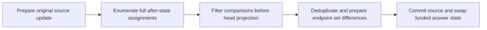

# Exact comparison-aware query owner

`CROWN::comparisons` is an opt-in public-IR interface for non-null exact-set CQs
with explicit comparison predicates. Include `crown/planner/comparisons.hpp` and
`crown/runtime/comparisons.hpp`. A genuine direct-CQ `PhysicalPlan` supplies the
equality body, original ordered/repeated head, source catalog and backend options.
`planner::comparisons::admit` adds a separate immutable predicate conjunction.
The [V70 acceptance](verification/comparison-support-v70-2026-11-16.md) records
actual source review, native checks and installed SDK execution.

## Typed admission

`Predicate` holds `left`, `operation` and `right`. Each operand is a `VariableId`
or owning `Value`; the six operators are `equal`, `not_equal`, `less`,
`less_equal`, `greater`, `greater_equal`. Variable operands must be bound by an
original query atom. Both operands must have the same ScalarType: exact int64,
binary strings, Boolean, finite Date or bounded Decimal. No implicit cast,
floating conversion, SQL NULL or collation change is introduced. Constants and
empty conjunctions are supported; every predicate must hold.

Admission copies caller predicates after operator/type/binding and literal-byte
admission. Its single cold grant counts entry, variable/atom/term visits,
predicates, operands and string bytes. Cold DTO allocations and inherited physical
validation retain their separate costs. `comparison_admission` rejects malformed
predicates or a SQL-normalized plan; `comparison_work_limit` rejects exhausted
selected work. Neither refusal changes the caller's plan or predicates.

The comparison predicates never enter the classical equality `Query`, its
recognition, identity or height proof. The equality SQL route continues to reject
cross-relation residual predicates. This API adds comparisons through public IR,
as permitted by Refactor.md; it does not expand the SQL grammar or admission.
The original CROWN tree is an admitted equality plan, not a comparison-tree proof.

```cpp
namespace pc = crown::planner::comparisons;
namespace cr = crown::runtime::comparisons;
// general is a genuine direct-CQ plan; x and z are its bound variable IDs.
const std::vector<pc::Predicate> predicates{{x, pc::Operator::less, z}};
auto selected = pc::admit(general, predicates);
cr::Runtime owner(selected); // Initially empty original physical sources.
auto epoch = owner.apply(update);
// epoch.added / epoch.removed are comparison answer SET differences.
auto current = owner.snapshot();
// current.rows own native payloads; their order is deterministic row order.
```

## Source and answer publication

One genuine PhysicalRuntime performs ordinary source/equality propagation and
full original UNIQUE/FK enforcement, including unused sources. All self-join alias
routes finish within its private source token. A change that does not cross any
native tuple's zero/positive boundary leaves every logical occurrence relation
unchanged; duplicate, filtered, unused and positive-to-positive derivation events
therefore preserve the comparison answer without recomputation.

For a changed native relation, the owner prepares an after-state epoch view and
enumerates complete assignments over all survivor factors. Variables are sorted
by ID, including hidden comparison operands. Predicates are evaluated BEFORE the
original head is projected and deduplicated. A nonlast matching hidden witness
cannot retract a projected answer; deleting its last witness can.



Private deduplication, output payloads and owning endpoint delta handles are
funded before source commit. A failure abandons that private work and the existing
source token restores its previous state. Valid source commit and equal-allocator
vector swap allocate nothing. One busy guard covers publication and old-state
retirement. No second undo journal, catch/retry framework or physical database
clone is added by this owner. Mandatory underlying epoch-view preparation and
cleanup retain their own costs.

`Epoch::input` is the original physical/support epoch; it is NOT the comparison
answer delta. `added` and `removed` are exact endpoint set differences, already
projected into the original head layout. Constant-true/nullary queries can yield
one empty tuple; constant-false routes yield none even when original variable/head
metadata remains. No-op inputs still advance the original source sequence.

## Ownership and resources

The original runtime account owns comparison metadata/literal bytes, scratch
deduplication, retained result tuples and output vectors. `Binding` retains the
actual conjunction and genuine compiled equality program. Its scalar/string views
borrow that immutable owner; keep the Binding alive while using them. Its original
`program().guarantee()` describes equality execution, not this wrapper. Binding is
not a canonical comparison identity, recovery image or durability authority.

Snapshot and Epoch tuple payloads share immutable funded native ownership and
survive runtime destruction. `snapshot()` copies funded owning handles from the
committed result, without recomputing witnesses or pinning a future source epoch.
`has_answer()` tests retained result nonemptiness. Calls on one owner require
external serialization. Independent owners have separate sources, sequence,
predicates and finite resources. `source_snapshot()` is an explicit full-source
ordinary caller DTO export, including filtered/unused tables.

`Options::sources` retains the existing source/propagation limits. `recompute.work`
is one wrapper balance through predicate freezing plus initial results during
construction, and one balance per complete later apply. It covers epoch-view
preparation, predicate/field/byte work, deduplication, materialization and endpoint
merging. View preparation receives only the wrapper balance remaining at that
point. `producer_work` is one cumulative native assignment-cursor allowance;
`rows` bounds distinct retained answers. Snapshot copying has its own explicit
Limits. Row/work/allocation refusal leaves committed sources, answers and sequence
unchanged. Resources are never replenished per witness or comparison.

## Cost and paper boundary

Let W be the number of complete assignments visited and A the distinct projected
answers. An update pays ordinary source/equality maintenance and after-view work,
then W predicate/projection visits with actual scalar widths, ordered deduplication
comparisons, answer materialization and old/new endpoint merging. W can greatly
exceed A, even when A is zero. Memory simultaneously holds old answers, private
distinct rows, new answer payloads and delta handles; they use the same finite
account. Snapshot copying is linear in answer handles. Cleanup and final-owner
destruction are real additional work. No constant startup, delay, termination or
dynamic comparison bound is claimed.

The research reference is Wang and Yi, [Conjunctive Queries with Comparisons,
SIGMOD 2022](https://www.cse.ust.hk/~yike/CQC.pdf),
[DOI 10.1145/3514221.3517830](https://doi.org/10.1145/3514221.3517830), 14 PDF pages.
The introduction, p1, explains the large intermediate cost of joining before
filtering. This implementation exposes that cost. It implements neither the
paper's supporting comparison trees nor its specialized evaluation bounds; those
static results do not establish an incremental bound for this owner. The primary
source observation is recorded separately from the local source/proof review.
