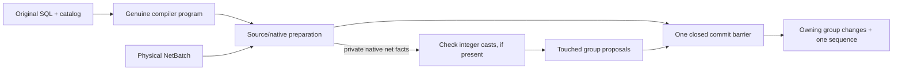

# Original SQL aggregate runtime

The separate CROWN::sql_aggregate_runtime library composes an authentic
[original SQL compiler](sql_aggregate_binding.md), [physical source batch](sql_rows_batches.md)
and group-only aggregate state. The library is built by default; applications
choose whether to link it. It accepts complete physical source rows and expected/
final weights. Read [primitive usage cards](code_specs/primitives.md) for exact
source blocks, owners, failure phases and measured cost boundaries.



## Usage and plan admission

Bind original SQL with frontend::bind_sql_aggregate, inspect its actual
source_program().export_core(), and obtain a checked CROWN source tree. Pass the
opaque program, that tree and physical options to SqlAggregateRuntime or its
create_into factory. Lowering checks the tree against the actual immutable source
program. A mutable export cannot replace binding authority.
The [installed public consumer](../build/verification/w06-sql-aggregate-runtime-implementation-v1/sdk-consumer-v1/main.cpp)
shows complete binding, tree selection, physical edits and ownership.

The derived source head must admit a CROWN tree. For a two-sided source selecting
a.g and b.y through an id join, GROUP BY a.id,a.g retains the separator as a hidden
full grouping key. SELECT may still omit id. Binding alone does not promise
arbitrary joined-source plan support. Qualified physical column identities remain
distinct under WHERE/join equality; source normalization cannot admit an originally
ungrouped selected column. Unsupported merged USING/NATURAL grouping references
retain their explicit compiler restrictions. Physical bigint columns can feed
checked integer casts in aggregate arguments without changing the source schema.

Prepare one sql_rows::NetBatch at sequence()+1. It contains physical TableId,
complete nullable cells, expected weight and final uint64 weight for each edit.
Repeated identity chains normalize to one final replacement; the source checks
final constraints and applies native removals before additions. Empty/no-op
commands still commit one sequence. Call commit() on the returned PreparedBatch,
or destroy/rollback it to discard preparation. Serialize all calls on one owner.

```cpp
auto pending = runtime.prepare_batch({runtime.sequence() + 1, edits});
auto epoch = pending.commit(); // Owning full-key changes; preview borrow ends.
```

Preparation finishes every throwing source/native/group/output operation. Commit
publishes already-funded native/source state and touched group nodes/scalars under
one closed token, then releases that token's backing workspace. It adds no second
undo system or production catch. Arithmetic, work, account and source-constraint
failures unwind the genuine child transaction and leave the committed epoch
unchanged. This API does not append a durable input or disposition record.

## State and lifetime

Persistent aggregate state stores only complete nullable group keys, row counts
and non-NULL counts/exact sums for distinct measures. It has no joined-row ledger.
Preparation copies each touched group's measure vector once; existing keys share
immutable owners and new keys own their bytes. Two passes consume genuine native
net facts: all removals, then additions. Final SUM bounds and before/after outputs
are checked once per touched group. W04 single-row immediate SUM behavior remains
unchanged; the shared private arithmetic helper avoids a second implementation.

The same helper checks every distinct narrowed integer column before projecting
its group key. NULL is admitted; an out-of-range value raises aggregate_overflow
and unwinds the existing source/native token. COUNT arguments and nested
narrow-then-widen casts use that check too. Filtered, unmatched or consolidated
net-zero source changes produce no contributing fact and do not evaluate the
aggregate cast. A later change that makes such a row contribute must pass it.
SUM(integer) retains its final bigint bound; AVG(integer) keeps the wide exact
numerator and does not acquire a bigint SUM bound.

Physical input spans/strings need remain valid only through prepare_batch. Active
tokens own the whole runtime after facade moves/destruction. Preview references
last only while their token is active and unmoved. Explicitly copied program,
Tuple and eager Snapshot handles own receiving storage. Snapshot creates no reader
lease. Snapshot, another prepare and source/root observations reject while a batch
is pending; account/program/sequence diagnostics remain available.

Global aggregation retains one empty-key group: COUNT is zero and SUM/AVG are
NULL on empty input. Grouped aggregation drops a group when its last row is
removed, including NULL-valued keys. Authenticated zero-occurrence source weight
zero/one bootstraps during construction at sequence zero. A real batch begins at
one; no synthetic operational command is inserted.

## Results and changed flags

Epoch.changed reports normalized physical weight changes, including filtered and
unused sources. group_changed reports genuine nonzero logical-bag input deltas;
it can be true when rounded/final output is equal. capture_changes requests owning
full-key before/final-after records. Distinct hidden keys stay distinct even when
projected values are equal. An absent group differs from a present all-NULL tuple.
Capture reserves for touched groups, so an empty change list can retain that
vector capacity until its Epoch is released.

Mandatory native D-fact capture is transient and released after group consumption.
Returned Epoch.native contains summary/work and any explicitly requested native
journals; bag_deltas is empty. Retaining one group result does not retain the
internal D-fact buffer. Releasing a closed token facade retains only its account
reference, not prepared capacity.

## Account and work costs

create_into uses its existing receiving account without changing its grant.
Foreign immutable programs are copied once from their actual private data; same-
account freeze shares them without allocation. Constant/name views are rebased to
stable receiving storage, including short strings. Default standalone runtime
grant is explicitly 256 MiB. Compiler workspace and its separate cold limits remain
as described by the binding contract; historic compiler work is retained provenance,
not a repeated compile charge.

The composed path pays the real native capture work, two D-entry scans, decoded
fields/presence/string bytes, group projection/probes, per-measure adjustments,
first-touch state copies and requested final rendering. Ordered group lookups and
detached-node insertion still compare keys. No untouched groups are finalized.
Selected counters do not meter every comparison, allocator or cleanup instruction.

For U distinct guarded columns, projection adds U selected work checkpoints per
contributing logical row/native delta, including NULL values. It adds no mutable
per-row/group/operator field, allocation, catch or rollback journal. The immutable
program has an additional accounted vector header even when U=0; nonempty guard
backing is copied only during binding/freezing. Legacy queries still pay the
accessor/empty-loop check. Compiler set deduplication is ordinary cold workspace,
and these counters do not establish a CPU timing bound.

The ordered Release comparison against the actual V31 installed SDK observes
56 additional accounted payload/requested bytes per immutable program, including
foreign freeze. Four legacy grouped/global and captured/uncaptured profiles
preserve allocation counts, selected work and exact binding images across sixteen
updates, with explicit COUNT/SUM/empty snapshot checks. Program/Epoch/Metrics remain 16/160/72 bytes in that
build. This is build-specific storage/work evidence; it does not measure CPU
time or every allocator. Checked two-column updates separately assert two extra
guard checkpoints and zero covered C++ new calls on a warmed uncaptured row.

Private receiving probes observe constant 939 additional accounted result bytes
for D=8/64/256 feeding one group, and group_work=16 for one touched group among
8/64/256 resident groups. Exact/one-under receiver-grant controls pass both
backends. These are observations on this build; they do not establish portable
sizes, CPU speed, a whole-operation O(G) bound or a paper aggregate-delay theorem.
The [executed receiving checks](verification/w06-sql-aggregate-runtime-2026-11-13.md)
record maintained Debug/SAN, installed SDK and the exact scope of each probe.

## Scope and provenance

The explicit [physical source image](sql_source_images.md) captures all original
tables and the actual native recipe/binding under one finite capture allowance.
It retains immutable row owners without adding update-path state. The closed
cold factory reconstructs genuine source/native/group state under separate build
limits; [receiving evidence](verification/w06-cold-rebuild-2026-11-13.md) records
its sequence, grant, ownership and independent SQL checks.

[Refactor W06](../Refactor.md) operational transactions and recovery are supplied
by the separate [Session](sql_aggregate_session.md), using the
[R2 records](sql_aggregate_records.md), [physical checkpoint](sql_aggregate_checkpoint.md)
and [actual WAL/sink files](sql_aggregate_files.md) supply separate components.
The upper [Session](sql_aggregate_session.md) now owns synchronous frontiers and
genuine selected-root replay. The separate [R2 JSONL/CLI path](sql_aggregate_input.md)
connects these primitives through Session. This in-memory token
alone supplies no durable recovery decision. Follow the [paper/source map](code_review.md) for
actual P1/P2 results; SQL ownership, accounting and failure contracts here are local
engineering and are not assigned Boolean-update or arbitrary aggregate bounds.
