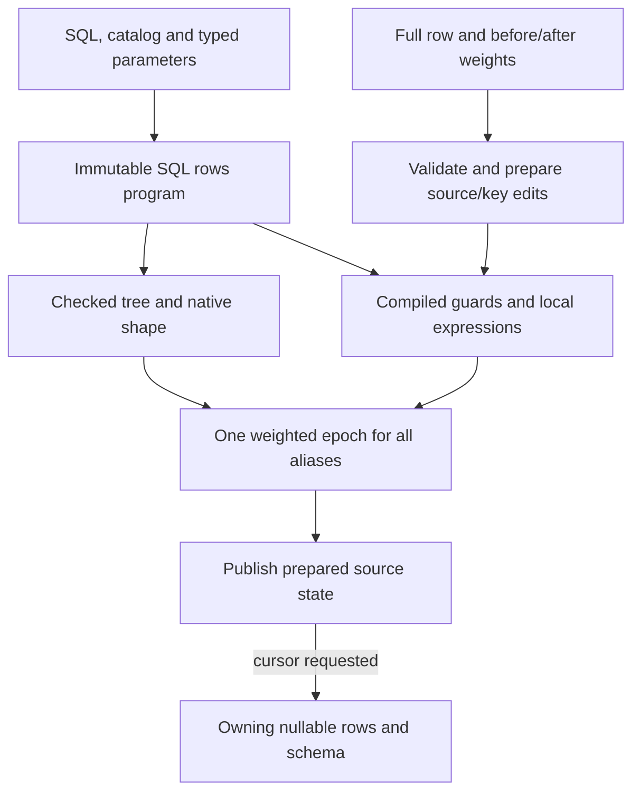

# Nullable SQL rows: implementation and inspection

The opt-in `crown_sql_rows` / installed `CROWN::sql_rows` component compiles
nullable SQL rows and routes physical bag-weight replacements into the existing
[weighted runtime](weighted_messages.md). W05 is verified for the admitted SQL
families, with mature-engine, resource and regression evidence recorded in the
[verification packet](verification/w05-sql-rows-human-inspection-2026-11-12.md). The older
set normalization formats keep their existing meanings. [W04 aggregates](aggregates.md)
remain a separate component; this runtime does not coordinate aggregate batches.

## Start at the two public boundaries

[`bind_sql_rows`](../include/crown/frontend/sql_rows.hpp) parses and binds the
actual source text, resolves equality guards and occurrence-local expressions,
and returns an immutable `SqlRowsProgram` or a binding diagnostic. A mutable
`BoundSql` is not an admission token. Compiler-owned arrays, names and retained
constants use its finite account. Parser/binder workspace and explicit DTO
exports remain cold work under the existing frontend contract.

`program.export_core()` produces a non-null `Catalog`/`Query` for tree choice.
[`SqlRowsRuntime`](../include/crown/runtime/sql_rows.hpp) exports the program
again and validates the supplied tree against that actual core before lowering.
Editing a previously exported DTO cannot change its authority. Tree lowering
establishes a checked executable upper bound; compilation alone does not prove
free-connexity or minimum height.

For example, after binding `SELECT x FROM r`, where `r.x` is nullable bigint:

```cpp
const auto core = program.export_core();
const auto chosen = crown::planner::minimum_tree(core.catalog, core.query);
// Inspect chosen.status and chosen.tree before constructing a runtime.
crown::runtime::SqlRowsRuntime runtime(program, chosen.tree.value());
using Cell = crown::runtime::sql_rows::Cell;
const std::array<Cell, 1> row{crown::storage::ScalarView{std::int64_t{7}}};
const auto epoch = runtime.apply({1, crown::TableId{0}, row, 0, 3});
auto cursor = runtime.results();
while (auto result = cursor.next()) {
  // result->tuple owns its nullable cells and string bytes.
  // result->multiplicity is 3 for this plain SELECT.
}
```

Use `create_into(account, program, tree, physical_options, options)` to retain
metadata and execution state in an existing finite account. Its actual cap is
authoritative, including earlier residents. Same-account program freezing shares
immutable metadata; cross-account freezing explicitly copies and rebases it.
Returned program spans borrow a live handle. Calls on one runtime, including
diagnostics, must be serialized.

## Representation and SQL semantics

| Boundary | Representation and identity |
| --- | --- |
| Physical source | Complete ordered optional scalar cells plus a nonnegative uint64 weight |
| Local expression slots | Optional inline values; text borrows source/program bytes |
| Ordinary join equality | Present equal operands only; two NULLs do not join |
| Nullable selected value | Core payload plus Boolean presence; NULL has one canonical payload |
| Plain SELECT result | One owning nullable tuple per distinct output, with exact multiplicity |
| SELECT DISTINCT result | The same nullable output identity, with positive weight replaced by one |
| Whole-result EXISTS | Exactly one non-null Boolean tuple, even when the inner bag is empty |

Both fields of a nullable selected value belong to the free head. Present zero,
false, empty text, epoch date and decimal zero therefore remain distinct from
NULL. Repeated references to a column class share its core fields; separate
computed-expression slots keep their own fields. Constant outputs use retained
slots and add no hidden distinguishing head fields. Every varying head field
is recoverable from the ordered SQL outputs. This makes the decoder injective
on reachable head tuples and permits output-weight consolidation before
DISTINCT changes positive weights to one.

Every unguarded nullable class belongs to one occurrence. An unconditional
cross-occurrence equality establishes non-nullness. A presence variable has the
same body-edge incidence as its payload and also belongs to the head edge;
adding/removing it preserves the running-intersection witness for those edges.
This local representation argument does not replace validation of the derived
query or establish bounds for arbitrary SQL rewrites.

Predicates admit TRUE only. Comparisons, Boolean tests and NULL tests use the
[shared scalar VM](sql_rows.md), following the
[PostgreSQL comparison rules](https://www.postgresql.org/docs/16/functions-comparison.html).
The [SELECT reference](https://www.postgresql.org/docs/16/queries-select-lists.html#QUERIES-DISTINCT)
defines ordinary duplicate removal. Local equality guards need no hidden core
field unless an output selects that class; only cross-occurrence equalities
retain hidden join fields.

Physical integer columns and declared parameters use int64/BIGINT; bound integer
literals and admitted casts also retain their int32 kinds. Other cells use
Boolean, the bounded native date/decimal domains, or UTF8 text without NUL.
Admitted int32 and fixed decimal ranges are checked. Text uses
the catalog's binary collation, matched by PostgreSQL UTF8 with C collation in
the intended oracle. Classical native byte strings keep their separate domain.
Typed parameters are specialized at compilation. Exact SQL, typed values and
complete catalog metadata enter the source key; it is a conservative source
binding, not the future alias-insensitive F05 key.

The existing binder determines supported syntax/casts. Cross-occurrence scalar
predicates other than extracted ordinary equalities, cross-occurrence computed
outputs, GROUP BY in this family, outer joins, and unimplemented syntax reject.
The aggregate binder's GROUP BY support does not make GROUP BY an alias for
output DISTINCT: projecting fewer grouping columns can produce repeated outputs.

All three output forms use the bounded weighted engine internally. Its exact
uint64 multiplicity limit applies to intermediate counts/products before
DISTINCT or EXISTS transforms the output. An update can therefore overflow even
when its DISTINCT/EXISTS output would be small. This component does not claim
Boolean maintenance bounds or silently saturate intermediate arithmetic.



## Physical replacement and constraints

[`Data::apply`](../src/runtime/sql_rows.cpp) authenticates `before` against the
complete physical row, then replaces its contribution in every affected alias
through one `WeightedRuntime::PendingEpoch`. Projected logical weight is
`current - before + after`, so hidden-column duplicates and self aliases retain
their independent source shares. A filtered row still belongs to the source
map. `Epoch.changed` reports source change independently of native output change.
A validated no-op advances sequence without evaluating aliases or changing keys.

Enforced catalog UNIQUE and foreign-key constraints use separate key indexes;
untrusted declarations do not constrain data. UNIQUE has fixed NULLS DISTINCT
semantics, and foreign keys use MATCH SIMPLE: a key with any NULL is exempt.
Fully present UNIQUE keys count multiplicity, so weight two already violates
uniqueness. Reverse foreign-key counters count live physical rows, sufficient
for parent-existence checks, rather than unnecessarily summing their weights.
These policies follow the
[PostgreSQL constraint reference](https://www.postgresql.org/docs/16/ddl-constraints.html).

The [catalog's empty-key extension](catalog.md) is preserved: UNIQUE `[]` means
at most one row; FK `[]` requires a nonempty parent. Self references probe the
proposed single-row state. Last-parent deletion checks reverse indexes, including
the removed row's own contribution. No source-table scan is used for enforcement.
Constraints are immediate for each single-row replacement. The separate
[prepared net-batch API](sql_rows_batches.md) validates final key counters and
supports final-valid swaps and self/cyclic changes. The separate
[original-SQL aggregate runtime](sql_aggregate_runtime.md) coordinates those
batches with groups; its [input/CLI path](sql_aggregate_input.md) admits physical
net commands.

New source/key nodes stay private until every constraint and native stage has
succeeded. Existing native journals roll back a failed epoch; source state has
not yet changed. After native commit, prepared node handles publish with equal
destination allocators and nonthrowing validated-key comparison. No full-state
copy, second native count map, retry layer, or source undo framework is involved.

## Ownership, costs and failure boundaries

| Operation | Actual work and retained state |
| --- | --- |
| Compile/freeze | Cold expression/schema traversal, arrays/text copies, serialization/hash and validation; explicit work visits do not bound all of it |
| Validate source | Full row width plus text/domain inspection, including unused columns |
| Probe source map | O(log distinct full rows) comparisons, each potentially inspecting scalar/text keys |
| Check constraints | Affected key projections and indexed parent/reverse probes; no complete source scan |
| Adapt aliases | The sum of their compiled guards, needed inputs/opcodes and projected fields; borrowed slots are cleared after use |
| Native maintenance | Existing affected-record/message work and its own finite grant; see weighted-runtime accounting |
| Emit result | Native compressed cursor work, then O(output width + copied text bytes) nullable ownership |

Source rows remain one owned tuple per distinct full row, including filtered
rows. Only enforced constraints allocate key state. Native logical consolidation
uses the existing counted rows. Scratch arrays are allocated at construction;
local adaptation makes no heap requests or temporary owning Row. Cleanup clears
only touched prefixes/slots. Grounded outputs reuse their class's fixed slot.
A cold liveness pass drops constants that no executable metadata reads, after
all string domains have been validated. Distinct retained constant slots can
still copy duplicate bytes; no interning/cache framework runs in the hot path.

The [before probe](../build/verification/w05-rows-constant-retention-probe-v1/README.md)
retained sixteen copies of one 1 MiB parameter for four grounded aliases:
16,784,756 requested bytes, exceeding the default 16 MiB compiler cap.
The [after probe](../build/verification/w05-rows-constant-retention-probe-v2/README.md)
uses one retained slot and 1,055,052 requested bytes, accepting the same query
under 3 MiB. This measures that fixture's retained compiler account, not all
temporary parser/compiler workspace or elapsed speed. It adds no update-path
lookup or constant cache.

Each replacement has one source allowance shared by validation, constraints and
all aliases. Native storage retains its existing separate epoch grant. The
source allowance meters selected structural visits and scalar fields/bytes,
not every map comparison, allocation or CPU instruction. Failed admissions keep
earlier debits. Cursor work limits cover the native enumerator; nullable decoding
and ownership have their explicit output-width/byte cost and account limit.

An owning result survives source retraction and runtime/cursor destruction.
`Result.schema` shares the immutable program, preserving column names, SQL kinds
and decimal typemods as well as its tuple's payload. This adds a handle copy,
without another metadata allocation or deep schema copy per result. A retained
result also retains that full program's metadata/constants until it is released.
Readers lease the writer through the last result until terminal `next`, cancel,
or destruction. EXISTS uses the root summary but retains the same native reader
lease machinery. The one output-boundary catch makes decoding/copy failure
terminal and releases that lease; it preserves the original exception. Source
updates use RAII and the existing epoch abort boundary, without another catch.

Invalid source/table/row, prior-weight mismatch, UNIQUE/FK violations and numeric
overflow reject before publication. Account failures retain their fixed resource
diagnostic. Compiler SQL rejection returns a diagnostic; parsing/binding retain
the older binder's diagnostic/exception rules. Private adapter contract faults
use fixed `IndexFailure`. No success or rollback refills an account or grant.

## Explicit prepared SQL output and recovery

V63 adds `prepare_output_batch` alongside the existing native-only preparation.
It decodes signed bag changes, DISTINCT support changes or EXISTS Boolean-row
replacements through one caller scratch row and one spent token allowance.
No per-update database snapshot or persistent result graph is added. Read the
[durable-row workflow](sql_rows_session.md) for output ownership, work/byte costs,
physical-source checkpoints and the separate V04 release boundary.

Recovery metadata is opt-in at binding: `retain_binding_image=true` retains the
exact canonical source/catalog/parameter image. Default ordinary binding avoids
that extra large-parameter copy; `source_sha256` retains its former meaning in
both modes. `binding_image()` borrows the retained bytes or returns empty when
unrequested. Only genuine compiler/freeze factories construct that backing.

## References and inspection order

Start with the two public headers, then compiler `predicates`, `fold_grounded`,
`core`, `schemas` and `freeze`; private `rows_detail::adapt`; runtime
`prepare_keys`, `proposed_count`, `apply`; and `ResultCursor::Data::next`.
The [code specifications](code_specs/README.md) map maintained source ranges.
The [compiler review](../build/verification/w05-sql-rows-human-review-v1/README.md)
pins the inspected pre-correction source and distinguishes findings from tests.

[Refactor.md W05](../Refactor.md) is the implementation requirement.
[Weighted enumeration](weighted_enumeration.md) connects the native recurrence
to the checked CROWN paper references in [the review guide](code_review.md).
SQL NULL encoding, C++ ownership, source constraints and allocation failure
behavior are local contracts; they are not claimed as paper theorems. The
verification packet records mature-engine agreement, native fault sweeps and an
installed-library consumer. W04 supplies the separate admitted grouped-aggregate
family. The separate [W06 runtime](sql_aggregate_runtime.md) and
[Session](sql_aggregate_session.md) supply joined aggregates, coordinated batches
and recovery within the [bounded V33 acceptance](verification/human-inspection-v33-2026-11-13.md).
