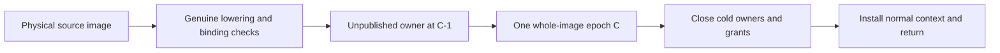

# Physical SQL source images

`SqlRowsRuntime::source_snapshot()` captures the actual complete physical bags.
`SqlAggregateRuntime::source_snapshot()` adds the genuine original aggregate
program around that child image. Both are eager, owning, quiescent operations.
They add no update-path state, joined-row cache or new exception boundary.

```cpp
auto image = runtime.source_snapshot();
// For a composed runtime, inspect image.source.rows and image.program.
```

The source image contains its committed sequence, actual `SqlRowsProgram`, the
executing immutable native `CompiledProgram`, actual weighted binding, capture
work and one `SourceEntry{source,row,weight}` per nonzero physical row. Table IDs
and row widths refer to the original complete catalog, including tables unused
by the query. Filtered rows, hidden columns, SQL NULL cells and their complete
unsigned multiplicities survive. Grouped/projected/native output is insufficient
to reconstruct this physical state.

Entries follow ascending original TableId and the source's exact nullable tuple
order. Empty tables remain represented by the retained source schema. Native
constant-zero/one routes can still have nonempty physical source images. The
actual source recipe/binding is observed from the owner, rather than inferred
from a caller-modified exported core query.

## Ownership and admission

The row vector uses the same receiving allocation account as the runtime. Row
entries share immutable complete Tuple owners instead of copying scalar payloads.
Program/recipe handles likewise retain immutable metadata. No mutable runtime,
reader lease or live cursor is kept. Images survive subsequent source updates,
erasure and facade destruction; releasing them drops their shared owners and
vector capacity. Shared payload remains charged to its original account/purpose,
without a second charge or a per-row ownership registry. Moving an image allocates
nothing; an explicit container copy can allocate a new entry vector.

Capture rejects while source/native preparation or a source result reader is
active. Composed capture first checks the outer batch state. Serialize calls on
one owner, as with other runtime APIs. Field/string validation already occurred
at genuine source admission and is not repeated by this reader.

## Limits and measured work

`SourceSnapshotLimits` defaults to 65,536 records and a finite `IndexWork`
allowance. The row ceiling is preflighted across every source before vector
reservation. One allowance then spans both source-list passes, each emitted row,
each physical field and each retained string extent. `scalar_bytes` admits string
lengths without rescanning UTF8 or copying payloads; it is not a CPU-instruction
or allocator-byte counter. The image reports the consumed allowance. Fixed
`storage::IndexFailure` reports work exhaustion; row exhaustion reports
`sql_rows_source_limit`; allocation failures propagate. Incomplete images unwind
through ordinary ownership without changing committed source/native/group state.

Capture visits source tables twice, every physical row once and every physical
field once, plus ordinary vector/reference-count/allocator costs. It does not
sort or compare full row keys again. The one entry-vector allocation and retained
owners are real costs, bounded by the query account. Retention can keep an erased
row's immutable storage alive until the last image releases it. No whole-update
complexity claim follows from these capture counters.

## Closed cold reconstruction

`SqlRowsRuntime::rebuild_into()` reconstructs the physical/native owner.
`SqlAggregateRuntime::rebuild_into()` also reconstructs its genuine groups.
Pass a receiving account, the image, original operational options, separate
finite build limits and an optional success report. For an ordered-backend image:

```cpp
sql_aggregate::RebuildMetrics used;
auto restored = SqlAggregateRuntime::rebuild_into(
    receiver, image, original_options, sql_aggregate::RebuildLimits{}, &used);
```

For indexed storage, explicitly set `limits.source.indexed_work` to one finite
`storage::IndexWork` build ceiling. Its presence must match the actual captured
backend. Use `sql_rows::RebuildLimits` and source options for the source-only API.
The default limits are finite admissions, not a promise that every image fits.

The factory exports the genuine source core and actual native tree/options,
runs the real lowerer, compares physical/source hashes, and checks the complete
weighted binding. It validates every physical row again, including positive
weights, full nullable types/UTF8, duplicate identities and final UNIQUE/FK state.
Whole-image preparation permits child-before-parent order. Group construction
uses the existing exact COUNT/SUM/AVG helpers and final-only SUM range checks.
It creates no caller-authored logical facts or second arithmetic implementation.

At sequence C>0, only unpublished owners start at C−1; one complete seed commits
at C. C=0 requires an empty physical image and initializes the authentic static
zero/one and global-empty cases once. UINT64_MAX is a valid terminal frontier;
the next command rejects. Reconstruction performs no C-length replay and exposes
no live sequence setter.

For C>0, the ownership and publication order is:



| Admission | Scope |
| --- | --- |
| `source.source_work` | One shared allowance for selected recipe admissions and the complete physical seed, constraints and alias work. |
| `source.native_work` | The one logical native seed epoch; constructor work is not included in this reported counter. |
| `source.indexed_work` | One outer indexed allowance spans native metadata import, materialization and the complete seed. |
| `group_work` | One budget spans authenticated initialization, native-fact decoding and final group preparation. |
| `source.lowering` | Existing finite host lowering/identity limits; original physical options remain bound. |
| Receiving account | Owns retained metadata, physical rows, native state, groups and temporary accounted state. Ordinary compiler DTO exports retain their existing allocation conventions. |

Cold journals, cursors, results and grants close before a fresh normal context is
installed. The returned owner uses the original operational limits; build grants
are neither retained nor refilled per row/chunk. No extra persistent update field,
joined-row mirror or production catch is added. Work depends on actual metadata,
physical rows, native propagation and groups; these counters do not bound every
allocator, comparison or CPU instruction. Reconstructed tuples/metadata belong
to the receiver, so releasing the image can release the original account while
the new runtime remains live.

Failure destroys unpublished state and leaves the original owner/image untouched.
The optional report is written only on success. Receiver current usage returns to
its prior live ownership; allocation-history/high-water counters need not rewind.
Existing lowerer, row/domain, fixed work and allocation errors propagate through
their existing carriers, without a new translation or retry framework.

## Recovery boundary

This API supplies an in-memory source image and actual execution metadata.
Its public container is editable; a descriptor/checkpoint loader must authenticate
the original SQL/catalog/parameters/tree and revalidate all decoded physical rows
through the genuine cold factory. Original count/options policy and durable C/I/D
authority require descriptor authentication outside this editable value. The
factory checks genuine source/shape/domain coupling; it cannot authenticate a
caller-supplied frontier, row set or missing search-optimality certificate.
The image is not a durable decision or trusted serialized program. [R2 records](sql_aggregate_records.md),
the [physical checkpoint](sql_aggregate_checkpoint.md) and [actual file owners](sql_aggregate_files.md)
supply separate components. Synchronous authority, selected-root/native replay and
CLI integration remain [W06 work](task_ledger.md).

The [composed runtime contract](sql_aggregate_runtime.md) explains the existing
physical transaction and group-only state. The [inspection map](code_specs/README.md)
supplies block-specific usage/cost references. Source-image ownership and capture
limits are local engineering contracts, with no additional paper-bound claim.
