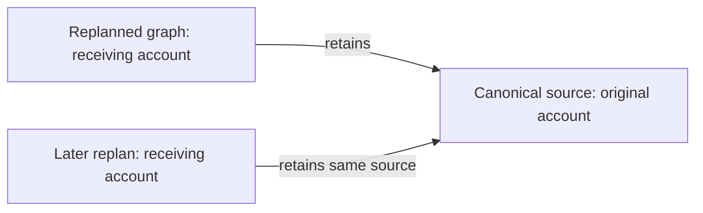

# V36 — replanning, memory and operation-budget usage

This review adds **176 source-bound usage cards in ten test files**. All 1,196
native inputs, including 355 production paths, remain byte-identical to V35.
The change adds no runtime handler, wrapper, allocation or work checkpoint.
No native build, CTest, SDK test or timing experiment runs in this packet.

The full Refactor.md goal remains active: **57 verified / 1 in progress (A02) /
20 not started**, 78 total. W06 retains its bounded verified profile. A02 still
blocks C04/B01; R2 retirement, V04 packaging and release gates remain open.

## Inspection coverage

The [source index](../code_specs/README.md) maps 751 files /
172,040 lines / 19,412 blocks, with 15,954
contracts in 13,538 blocks. All selected non-test regions have
usage cards; **655 selected test regions remain**. Other unreviewed scaffolding
keeps structural facts only. Mapping and card presence do not prove all semantics
or certify every existing comment.

| Source | New cards | Usage inspected |
| --- | ---: | --- |
| [Native replanning](../code_specs/files/tests/unit/native_replanning_test.cpp.md) | 25 | Exact compiler graphs, canonical-source sharing, receiving accounts, caps and copies. |
| [Independent selection bytes](../code_specs/files/tests/unit/selection_binding_independent_test.cpp.md) | 17 | Literal framing, raw field mutations and finite encoding budgets. |
| [Ranking exceptions](../code_specs/files/tests/unit/ranking_exception_test.cpp.md) | 15 | Covered allocation attempts, retained score fields and owner/workload stability. |
| [Session preparation](../code_specs/files/tests/unit/reoptimization_session_test.cpp.md) | 18 | Snapshot/catch-up barriers, paused queues, limits, cancellation and original output. |
| [Plan installation](../code_specs/files/tests/unit/reoptimization_install_test.cpp.md) | 17 | Native owner switch, selected-artifact recovery, windows and sink lineage. |
| [Generation descriptors](../code_specs/files/tests/unit/reoptimization_generation_test.cpp.md) | 16 | Root/hash/descriptor protocol, uncertain selection and low-level retirement. |
| [Installation faults](../code_specs/files/tests/unit/reoptimization_install_fault_test.cpp.md) | 16 | Genuine compiler artifacts, observed syscall cuts, allocation refusal and retry. |
| [Delta memory](../code_specs/files/tests/unit/delta_memory_test.cpp.md) | 18 | Native live/index bytes, rollback, prepared transfer and cursor lifetime. |
| [Session memory](../code_specs/files/tests/unit/session_memory_test.cpp.md) | 17 | Snapshot capacity, immutable collection sharing and retained-account limits. |
| [Indexed budgets](../code_specs/files/tests/unit/indexed_runtime_budget_test.cpp.md) | 17 | Aggregate work grants, smaller-fanout repair, capacity and exact annotations. |

Each card records purpose, inputs/outputs, invariants, ownership, failure, cost
and real references. [Paper context](../code_review.md), [memory contracts](../query_memory.md),
[indexed storage](../indexed_storage.md) and [barrier reoptimization](../reoptimization.md)
separate theoretical algorithm claims from local allocator, publication and
recovery obligations.

## Ownership and performance boundaries

Native replanning retains one canonical admitted compiler source. New graph
instructions and tokens use the receiving account; that graph can keep the
source account alive through the shared canonical basis. Repeated replans retain
the same basis rather than a chain of former graphs. Deep compiled-program
admission into another account has a different lifetime boundary.

The diagram shows the cross-account case. Ordinary replan uses its basis account.

The source checks these concrete limits:

- Native lifetime assertions sometimes compare current byte totals; those are
  distinct from explicit allocator/account owner-ID checks. The receiving replan
  checks source controller-only after the derived output is released. Deep-copy
  admission checks it while the independent receiving copy remains held.
- Projection inventories contain borrowed pointers. Their type expression with
  indexes()[0] is unevaluated and does not require a nonempty index list. Alias
  comparison checks all pointer-token pairs and has quadratic pair count.
- Native persistent replanning makes 2N+3 calls including retained baseline and
  calibration. Deep-copy fault staging makes 2N+2 copy calls. Cap helpers use at
  most 1,024 discovery calls, then two retained-pin probes and one retry. Most
  fault/cap cases use candidate zero; family-wide traversal belongs to equivalence
  and churn. These are source schedules, not new executions or CPU measurements.
- Raw tree/normalized encoding fixtures deliberately contain inadmissible
  records. They test byte representation without proving or lowering those
  records. Independent literal framing covers scalar/tree/core records; mutation
  checks include 17 tree, 38 core and 79 normalized changes. The normalized checks
  compare changed records with a production baseline. Default budgets are finite;
  Decimal and nested-CQ records have
  additional charges beyond the simple string equality check.
- The ranking exception driver covers its unaligned replacement-new operators.
  It retries once after each whole policy sweep. Its result image contains named
  score fields, not the complete result graph; retained baseline usage is checked
  separately. Nothrow allocation and constructor-failure deallocation have their
  actual C++ ownership rules.
- A MemoryAccount handle retains its controller, while runtime/tuple/context
  owners retain payloads. Selected attribution queries scan the allocation list.
  Delta helpers perform three such scans for this fixture's three attribution
  IDs. Equal selected usage does not establish equal whole-account usage.
- Snapshot exact row limits use measured capacity to reproduce growth. Copies
  share immutable collection storage; tuple construction and collection framing
  remain charged. Three ordinary-session controls and five window-session
  controls are fixture-specific observations. Arming allocation denial alone
  does not assert that no failed allocation attempt occurred.
- One IndexWork grant has five dimensions shared across an outer operation.
  Compilation metadata has a separate allowance. Indexed repair reduces fanout
  from 48 to 47 before a later successful input; it does not replay the identical
  failed state. The above-2^53 annotation case seeds a private count, increments
  it through a real update, then restores it; it does not build a huge dataset.

## Barrier and fault scope

Session preparation verifies a private target and cancels it; publication is a
separate operation. The preparation main counts 16 ordinary profiles. Installation
counts 24 ordinary profiles plus 12 additional helper invocations. Comparison
with a non-switching reference preserves the tested epochs, outputs and window
state. Command sequence and physical epoch are deliberately distinct.

GenerationOwner's opaque descriptor/checkpoint strings test the file protocol,
not compiler replay. The installation-fault fixture uses genuine compiler
artifacts and durable output epochs. Observed syscall before/after cuts and
forked exits cover those boundaries; they do not cover every instruction or
host power loss. The allocation guard is armed before the root-rename seam.
Plan/checkpoint/WAL synchronization order, uncertain-selection latches, benign
ENOENT cleanup and valid next input have separate assertions.

Failure categories remain exact. Some discovery campaigns stop at their first
nonthrowing completion; calibrated campaigns explicitly measure N and fault
positions 0 through N-1. Standard-exception handlers do not catch every thrown
type, and the indexed-budget main has no outer catch. Input mode strings also
follow their actual branches: unknown generation mode uses the I/O path;
unknown installation-fault mode uses allocation tests.

## Review and preserved evidence

Three author packets and three independent reviewer packets remain immutable.
Root independently reads all 2,225 target lines and relevant callers before the
cards, checks actual frozen missing-region sets including all ten entrypoints,
and replays exact field amendments before adoption. Canonical payload digest
and seal-file digest are kept distinct. Large inventory/registry inputs are
pinned at existing frozen paths rather than copied into each packet.

The [receiving packet](../../build/verification/inspection-replanning-tests-v36-v1/README.md)
contains source notes, author/reviewer hashes, amendments, native-input identity,
regenerated coverage and link results. Generation completes before checks;
current source hashes, anchors, local destinations/fragments and no stale/unused
cards are verified. External URLs retain the checker's explicit skipped status.

Latest boundary: `build/verification/human-inspection-v36-progress-v1.json`,
frozen source `build/verification/human-inspection-v36-source-v1`. The exact
previous handoff is [V35 history](../handoff-history-v35-2026-11-13.md).
[V33 native acceptance](human-inspection-v33-2026-11-13.md) and V32's broader
SQL/installed receipts retain their dated attribution. No new full 348-test,
fresh Clang, benchmark or release claim follows from source identity. The full
goal and remaining individual inspection stay active.
